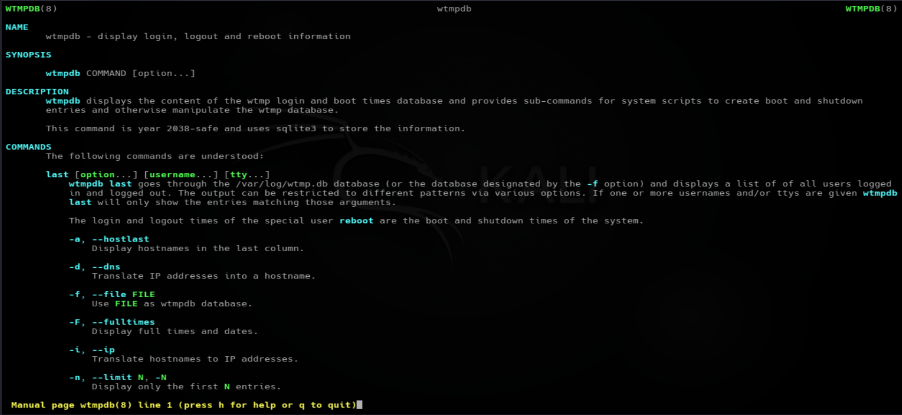
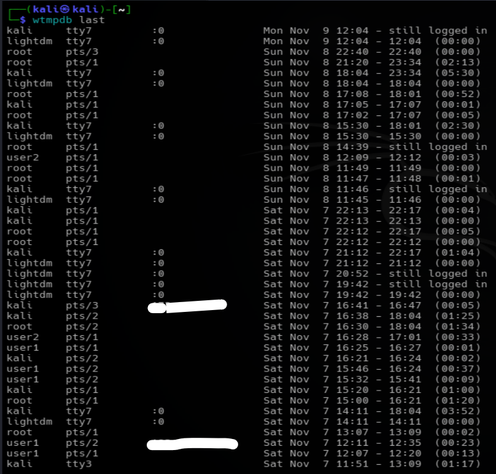
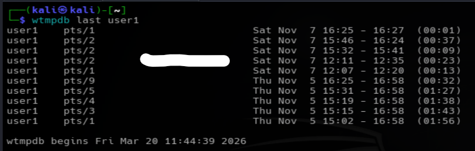
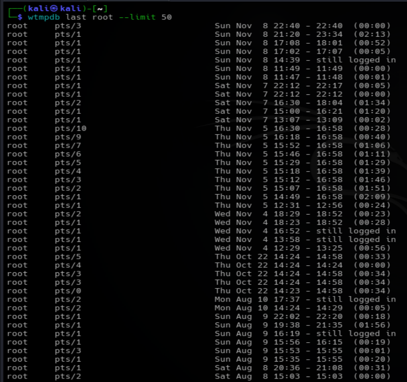
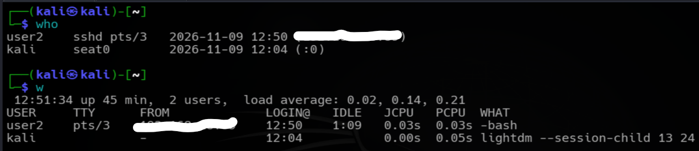

# Login History Monitoring with `wtmpdb`
*Maintained by Muhammad Awais*

## What is `wtmpdb`?
wtmpdb stands for wtmp Database.
- wtmp: Traditionally refers to the Who logged in? system accounting database.
- db: Database.

`wtmpdb` is a Linux command-line utility used to view historical login, logout, and system reboot information.

It reads login records from the `/var/log/wtmp.db` database and helps administrators understand who accessed the system and when.

It is useful for monitoring user login activity and investigating unusual login behavior.

### Basic Syntax

```bash
wtmpdb COMMAND [options]
```


### Display login history

```bash
wtmpdb last
```
Displays the login and logout history of users on the system.


### Check login history for a specific user

```bash
wtmpdb last username
```
Replace `username` with the actual account name to filter the results.

### Understanding the Output

**Example:**

```text
user1    pts/2    X.X.X.X    Sat Nov 7 12:11 - 12:35  (00:23)
```
| Field | Explanation |
|---|---|
| `user1` | The username of the account that logged in. |
| `pts/2` | The pseudo-terminal assigned to the user's session. It usually represents a terminal session accessed remotely, such as through SSH. |
| `X.X.X.X` | The IP address recorded as the source of the login session. |
| `Sat Nov 7` | The date when the user logged in. |
| `12:11` | The login time. |
| `12:35` | The logout time. |
| `(00:23)` | The total session duration, approximately 23 minutes. |

**Example interpretation:**

The user `user1` logged into the Linux system from IP address `X.X.X.X` using pseudo-terminal `pts/2` on Saturday, November 7, at 12:11. The session ended at 12:35 and lasted approximately 23 minutes.

### Check root login history

```bash
wtmpdb last root
```
Here the `--limit` option means "display only first N enries". There are also other options/flags we can check these by `wtmpdb --help | last --help | man wtmpdb`

Displays recorded login activity associated with the root account.

### Why is `wtmpdb` useful?

System administrators and SOC analysts can use this command to:

- Review historical user login activity.
- Identify unexpected login times.
- Monitor root account access.
- Investigate unusual login patterns.
- Check recorded system boot and shutdown events.

**Important:** `wtmpdb` displays historical records, not currently active sessions. Use `who` or `w` to view current logged-in users.


For security investigations, correlate login history with authentication logs, such as `/var/log/auth.log` or `/var/log/secure`, depending on the Linux distribution.

### Summary

`wtmpdb` is useful for reviewing historical login and logout activity. It helps administrators monitor account access and provides supporting information during security investigations.