# LINUX ARCHIVING AND COMPRESSION COMMANDS DOCUMENTATION
*Maintained by Muhammad Awais*

## Archiving vs Compression

Archiving means bundling multiple files or folders into a single file, without shrinking their size at all. It is purely about combining things into one package so they are easier to move around or store.

Compression means actually reducing the size of a file, encoding the data more efficiently so it takes up less space on disk.

Think of it like packing for a trip. Archiving is putting all your clothes into one suitcase, the total weight stays exactly the same, it is just now one bag instead of ten loose items. Compression is vacuum sealing those clothes, the same items now take up noticeably less space.

Most real world tools do both at once, first archiving everything together, then compressing the result, which is exactly why formats like `.tar.gz` and `.zip` exist.

## tar, the Main Archiving Tool

`tar` (short for tape archive) is the standard tool for bundling files and folders together on Linux.

### Creating a basic archive, no compression

```
tar -cvf archive.tar folder/
tar -cvf archive.tar file1 file2 file3
```

| Flag | What it means |
|---|---|
| -c | Create a new archive |
| -v | Verbose, show what is happening as it works |
| -f | File, specify the name of the archive |

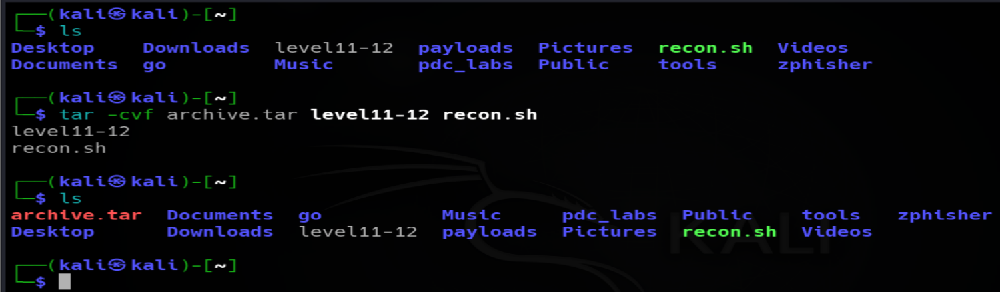

### Extracting an archive

```
tar -xvf archive.tar
```

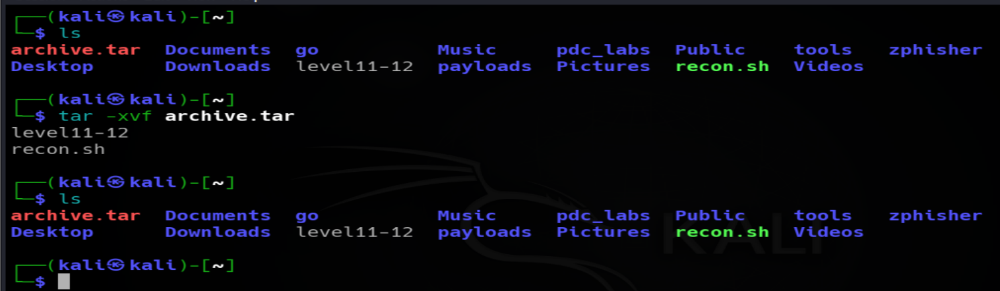

### Listing the contents without extracting

```
tar -tvf archive.tar
```

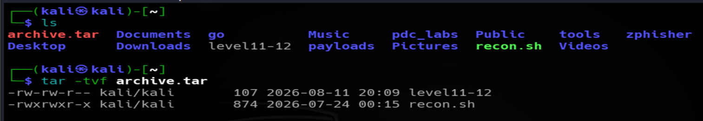

### Combining tar with compression

`tar` on its own does not compress anything, it only bundles. Compression gets added by pairing it with an extra flag.

**With gzip (produces .tar.gz):**
```
tar -czvf archive.tar.gz folder/
```

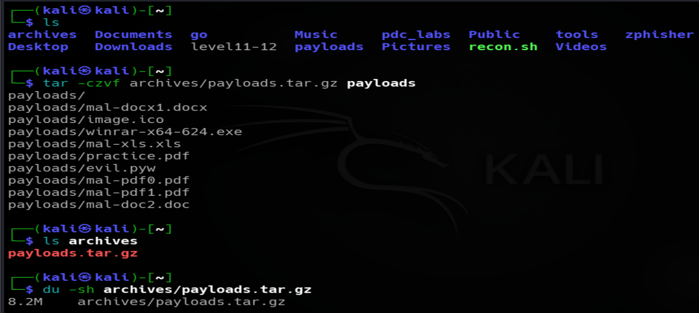

**Extracting it (tar.gz):**
```
tar -xzvf archive.tar.gz
```
Here, the `-C` is used when we want to extract the archive into a specific directory of our choice instead of the current directory.
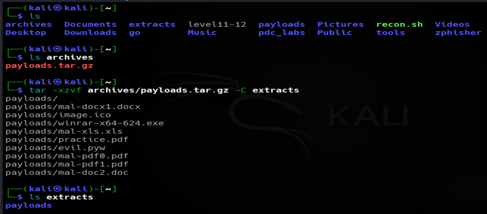


**With bzip2 (produces .tar.bz2):**
```
tar -cjvf archive.tar.bz2 folder/
```
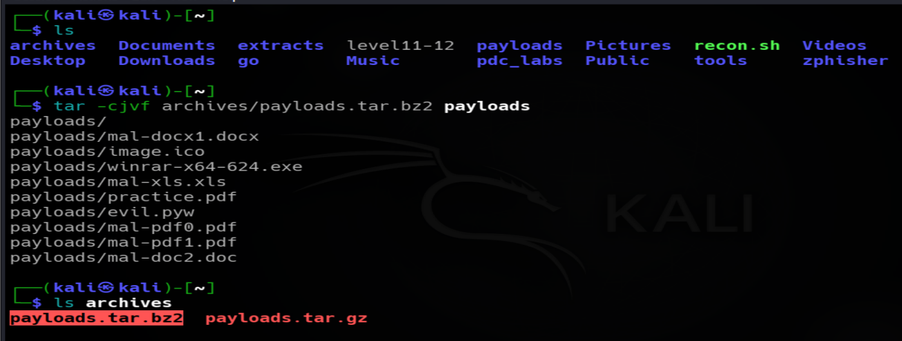

**Extracting it (tar.bz2):**
```
tar -xjvf archive.tar.bz2
```

Here, the `-C` is used when we want to extract the archive into a specific directory of our choice instead of the current directory.
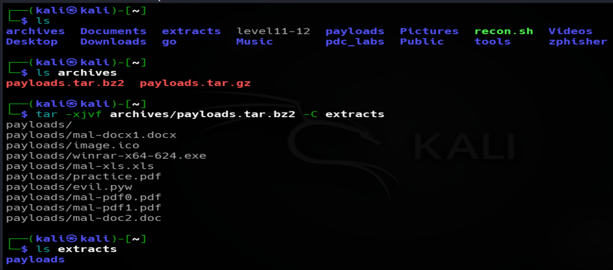


**With xz (produces .tar.xz):**
```
tar -cJvf archive.tar.xz folder/
```
Note the capital `J` here, lowercase `j` is bzip2, capital `J` is xz.
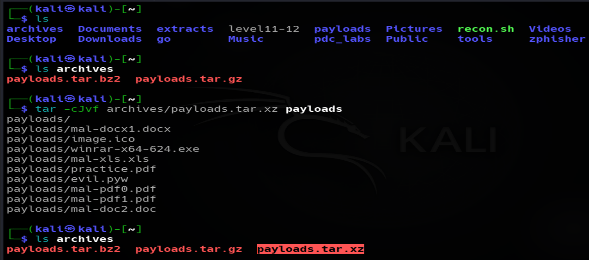

**Extracting it (tar.xz):**
```
tar -xJvf archive.tar.xz
```
Here, the `-C` is used when we want to extract the archive into a specific directory of our choice instead of the current directory.
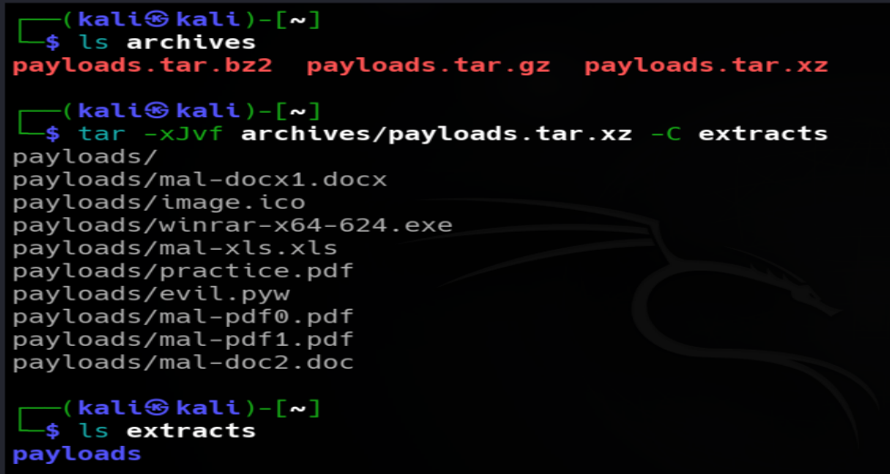

### Extracting into a specific folder

The destination folder needs to already exist, `tar` will not create it automatically.

```
mkdir newfolder
tar -xvf archive.tar -C newfolder
```

### A common mistake worth knowing about, absolute paths

If an archive or compressed archive is created using a full path starting with a slash, like this for example:
```
tar -cvf /home/kali/payloads.tar.xz /home/kali/payloads
```
The archive ends up storing that entire path structure inside it. 

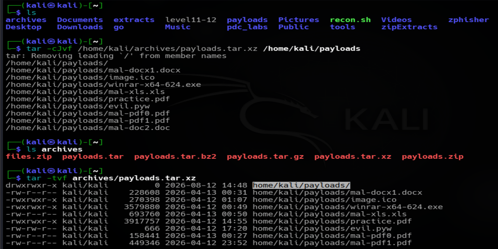


Extracting it later recreates the whole `home/kali/payloads` folder chain inside the destination, instead of just dropping a clean `payloads` folder there.

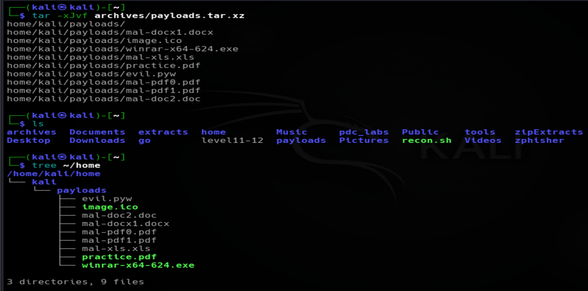

To avoid this, move into the source directory first using `-C`, then reference the folder by its relative name only:
```
tar -cJvf /home/kali/payloads.tar.xz -C /home/kali/ payloads/
```

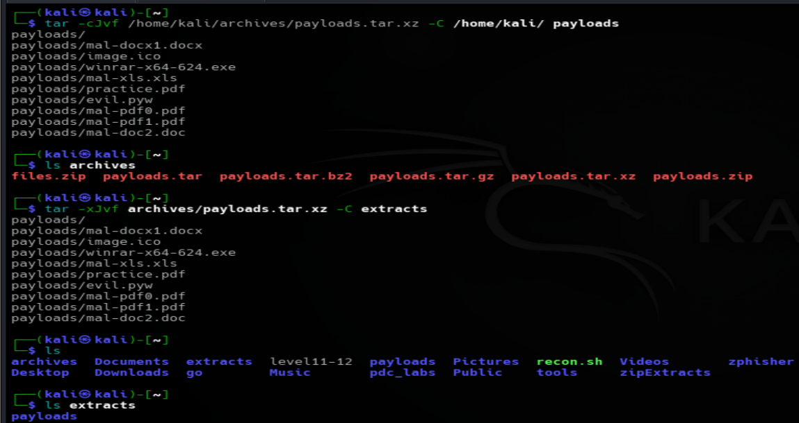

This way, only `payloads` and its contents get stored, not the full absolute path leading up to it.

## gzip, Compressing a Single File

`gzip` only works on one file at a time, it does not bundle folders together on its own, which is exactly why it usually gets paired with `tar` for that part.

### Compressing a file

```
gzip file.txt
```
This replaces `file.txt` with `file.txt.gz`, the original gets removed in the process.

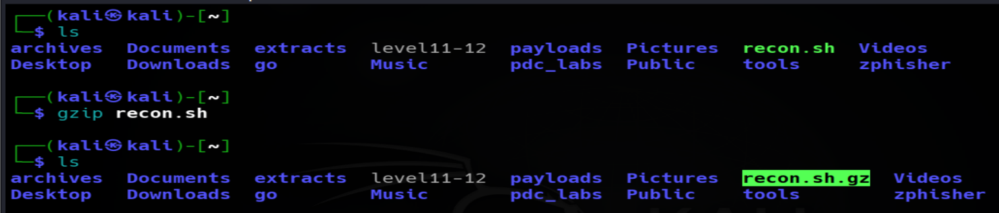

### Decompressing

```
gzip -d file.txt.gz
```
or
```
gunzip file.txt.gz
```

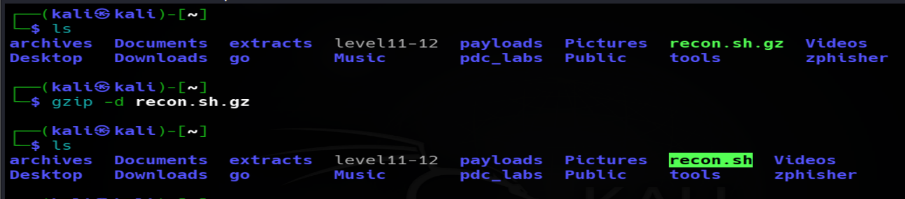

### Keeping the original file instead of replacing it

```
gzip -k file.txt
```

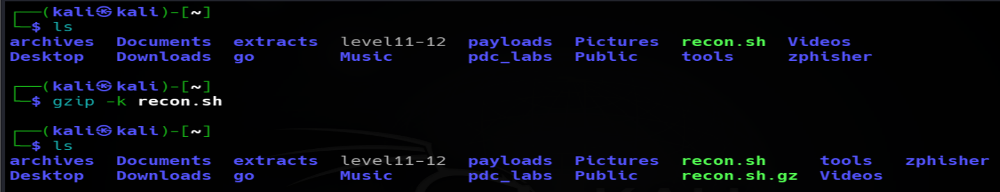

## bzip2, Similar to gzip but Better Compression

Same basic idea as gzip, but a different algorithm, it usually compresses a bit tighter at the cost of being somewhat slower.

```
bzip2 file.txt
```
Produces `file.txt.bz2`.

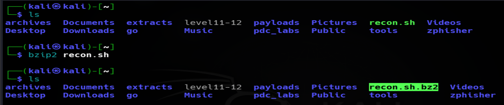

Decompressing:
```
bzip2 -d file.txt.bz2
```
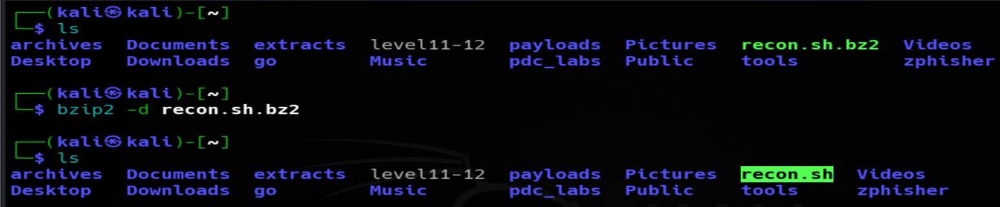

Keeping the original:
```
bzip2 -k file.txt
```

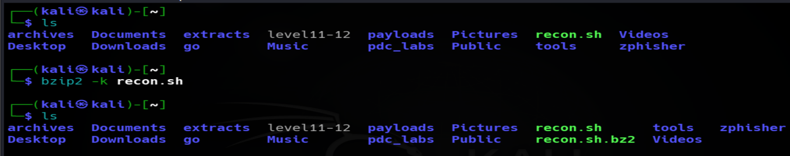

## xz, the Strongest Compression, Also the Slowest

Generally produces the smallest file size out of the three, but takes noticeably more CPU time and effort to do it.

```
xz file.txt
```
Produces `file.txt.xz`.

Decompressing:
```
xz -d file.txt.xz
```

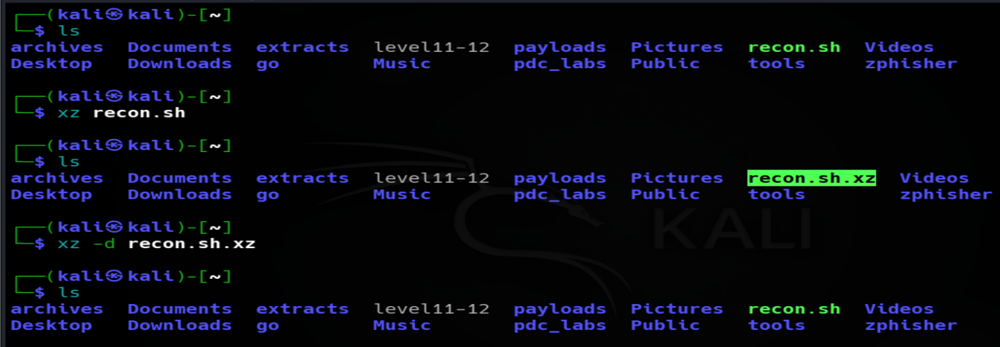

Keeping the original:
```
xz -k file.txt
```

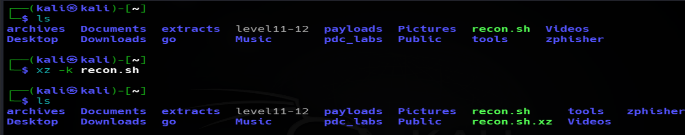

## zip and unzip, the Windows Friendly Format

Unlike gzip, bzip2, and xz, `zip` both archives and compresses in a single step, and it has the advantage of opening natively on Windows without needing any extra tools.

### Creating a zip archive

```
zip archive.zip file1.txt file2.txt
```
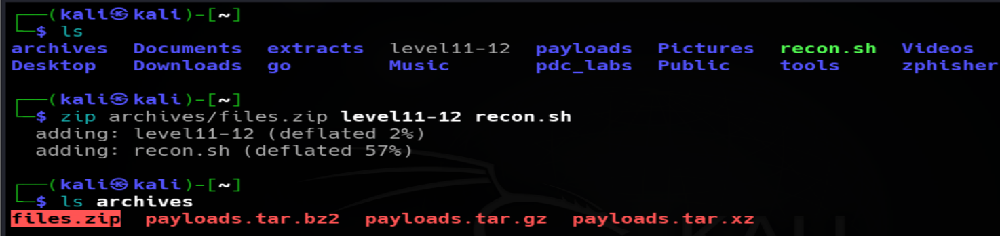

For an entire folder, `-r` (recursive) is required:
```
zip -r archive.zip folder/
```

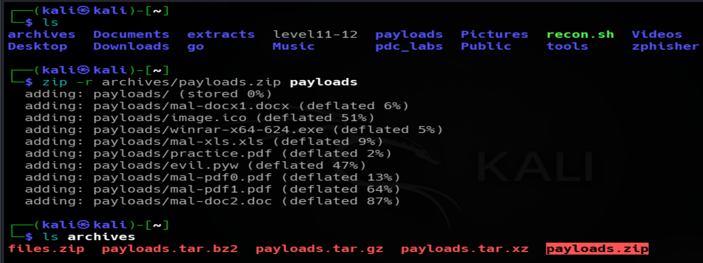

### Extracting zip archive

```
unzip archive.zip
```

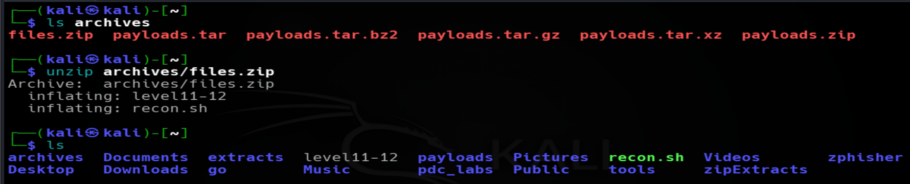

### Extracting into a specific folder

```
unzip archive.zip -d /path/to/destination/
```
Unlike `tar -C`, `unzip -d` will actually create the destination folder automatically if it does not already exist.

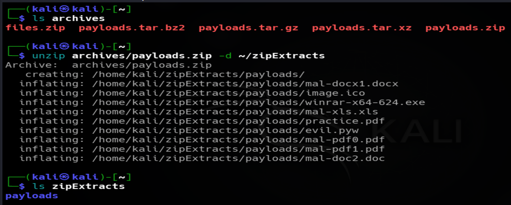

### Listing contents without extracting

```
unzip -l archive.zip
```

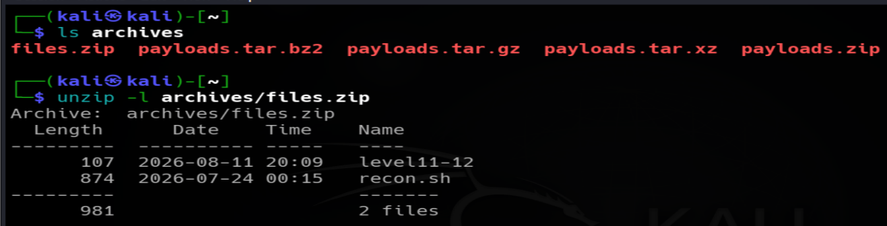

## Comparing Compression Sizes

Once a few different compressed versions of the same folder exist, comparing their actual sizes is a good way to see the real difference between the tools.

```
du -sh archive.tar
du -sh archive.tar.gz
du -sh archive.tar.bz2
du -sh archive.tar.xz
du -sh archive.zip
```
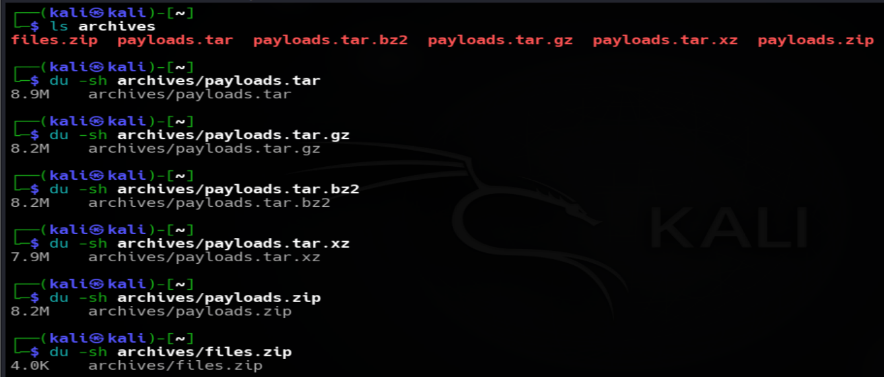
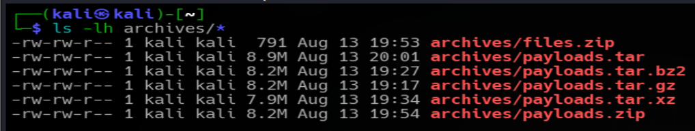

## Quick Comparison Table

| Tool | Archives (bundles files)? | Compresses? | Speed | Compression strength | Best for |
|---|---|---|---|---|---|
| tar | Yes | No, on its own | N/A | N/A | Bundling files and folders together |
| gzip | No | Yes, single file only | Fast | Medium | Quick, everyday compression |
| bzip2 | No | Yes, single file only | Medium | Better than gzip | Stronger compression, a bit slower |
| xz | No | Yes, single file only | Slow | Strongest | Maximum compression when time allows |
| zip | Yes | Yes, both together | Fast | Medium | Sharing files with Windows users |

## Commands discussed in this file for "archiving and compression"

| Command | Variants used |
|---|---|
| `tar` | `tar -cvf`, `tar -xvf`, `tar -tvf`, `tar -czvf`, `tar -xzvf`, `tar -cjvf`, `tar -xjvf`, `tar -cJvf`, `tar -xJvf`, `tar -xvf archive.tar -C folder`, `tar -cvf archive.tar -C /home/kali payloads` |
| `gzip` | `gzip file.txt`, `gzip -d file.txt.gz`, `gzip -k file.txt` |
| `gunzip` | `gunzip file.txt.gz` |
| `bzip2` | `bzip2 file.txt`, `bzip2 -d file.txt.bz2`, `bzip2 -k file.txt` |
| `xz` | `xz file.txt`, `xz -d file.txt.xz`, `xz -k file.txt` |
| `zip` | `zip archive.zip file1.txt file2.txt`, `zip -r archive.zip folder/` |
| `unzip` | `unzip archive.zip`, `unzip archive.zip -d folder/`, `unzip -l archive.zip` |
| `du` | `du -sh archive.tar.gz` |
| `ls` | `ls -lh archive.*` |