# LINUX DISK MANAGEMENT DOCUMENTATION
*Maintained by Muhammad Awais*

## Concepts Covered
Before starting the practical work, understand these basic concepts.

### 1. Disk
A disk is a physical or virtual storage device used to save data. In this practical, the USB drive is the disk. Linux identifies the whole USB drive as `/dev/sdb`, `/dev/sdc`, `dev/sdc` etc.

### 2. Partition
A partition is a separate section of a disk. A disk can contain one or more partitions. Linux identifies the partitions of `/dev/sdb` as `/dev/sdb1`, `/dev/sdb2`, and so on.

### 3. Partition Table
A partition table stores information about how a disk is divided into partitions. It tells the operating system where each partition starts and ends.
The two partition table types used in this practical are GPT and DOS.

### 4. GPT Partition Table Type
GPT stands for GUID Partition Table. It is a modern partition table format. It supports large disks and many partitions. We create it using the `g` command inside `fdisk`.

### 5. DOS or MBR Partition Table Type
DOS is also known as MBR, which stands for Master Boot Record. It is an older partition table format. We create it using the `o` command inside `fdisk`.
GPT and DOS are partition table types. They are not filesystems.

### 6. Filesystem
A filesystem organizes data on a partition. It manages how files and folders are stored and accessed.

Common filesystem types used in this practical are:

| Filesystem | Common use |
|---|---|
| ext4 | Common Linux filesystem |
| exFAT | Useful for sharing files between Linux, Windows and other systems |
| FAT32 | Older filesystem supported by many devices |
| NTFS | Commonly used by Windows |

### 7. Formatting
Formatting prepares a partition by creating a filesystem on it. Formatting a partition removes the existing filesystem data from that partition.

For example, `mkfs.ext4` creates an ext4 filesystem.

### 8. mkfs
`mkfs` means make filesystem. It is used to create a filesystem on a partition.

Examples:

```bash
sudo mkfs.ext4 /dev/sdb1
sudo mkfs.exfat /dev/sdb2
```

### 9. Filesystem Checking

Filesystem checking looks for filesystem errors or inconsistencies. Different filesystem types use different checking commands.

Examples:

```bash
sudo e2fsck -fn /dev/sdb1 , sudo fsck.ext4 -n /dev/sdb1
sudo fsck.exfat -n /dev/sdb2
sudo fsck.vfat -n /dev/sdb2
```
Here the `-n` means that check the partition filesystem without modifying or changing it.
For NTFS, Linux provides `ntfsfix` for limited checks and repairs. It is not a full replacement for Windows `chkdsk`.

### 10. Mounting and Mount Point
Mounting makes a partition accessible through a directory in Linux. That directory is called a mount point.
For example, `/mnt/usbDrive` can be used as the mount point for `/dev/sdb1`.

### 11. Unmounting
Unmounting safely disconnects a mounted filesystem from its mount point. A partition should be unmounted before removing the USB drive or performing filesystem checks. Unmounting a partition doesn't means that the content on the partition will be removed, unmounting simply disconnects the partition from the linux directory entry.

### 12. Backup
A backup is a separate copy of important data. It should be created and verified before changing a partition table or formatting a partition because these operations can erase data.

### 13. Device Names
Linux uses device names to identify disks and partitions. In this practical, `/dev/sdb` represents the whole USB drive, while `/dev/sdb1` and `/dev/sdb2` represent its partitions.
Device names can change when storage devices are connected or disconnected. Always confirm the correct device with `lsblk` before running commands.

## Practical Implementation

The practical work starts by connecting the USB drive, identifying it, and backing up its data. After that, we create GPT and DOS partition tables, format and check the filesystems, and practice mounting and unmounting the partitions.

## 1. Connecting the USB Drive

First, connect the USB drive to the computer and make sure it is connected to the Kali Linux virtual machine.

Check the available storage devices:

```bash
lsblk
```

Check the filesystem information:

```bash
lsblk -f
```

Identify the USB drive. In this practical, the USB drive is `/dev/sdb` and its existing partition is `/dev/sdb1`.

**Important:** Device names can change. Always check `lsblk` before running partitioning or formatting commands. Make sure you have selected the USB drive and not the system disk.

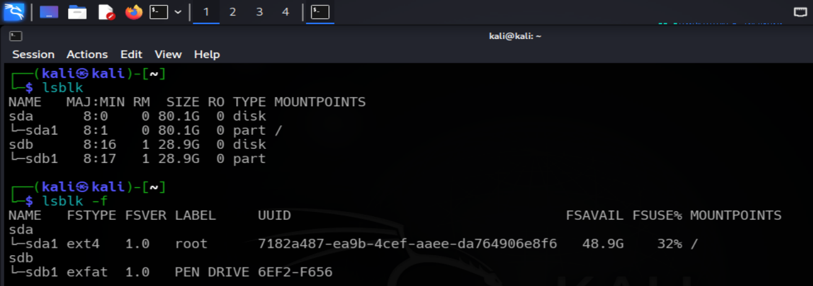

## 2. Taking a Backup of the USB Data
Before changing the partition table or formatting the USB/Disk, keep a backup of its important data to avoid accidental data loss.
First, identify where the USB partition is mounted and then create a backup directory in your home directory:

```bash
mkdir -p ~/usb-backup
```

Copy the USB data to the backup directory. Replace the source path with the actual mount path shown on your system:

```bash
rsync -avh --progress /source-directory ~/destination-directory
```

Check that the backup exists:

```bash
ls -lah ~/destination-directory
```

**Screenshot 2: USB backup command**

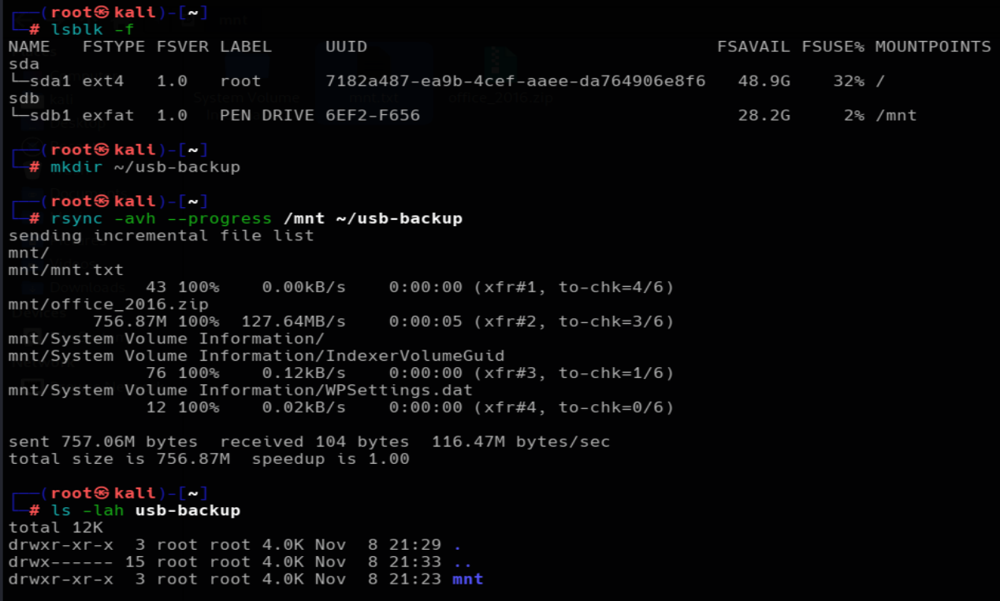

Breaking Down the rsync Backup Command
`rsync -avh --progress /mnt ~/usb-backup/`

This command copies all files and folders from the USB drive to the backup directory.
`rsync`: A command used to copy and synchronize files and directories.

`-a`: Archive mode. It copies directories recursively and preserves file permissions, timestamps, and other attributes where possible.

`-v`: Verbose mode. It displays the names of files being copied.

`-h`: Displays file sizes in a human readable format, such as KB, MB, and GB.

`--progress`: Shows the copying progress of each file.

`/mnt`:	The source directory. This is the location where the usb is mounted.

`~/usb-backup/`: The destination directory. This is where the backup will be stored.

## 3. Checking the USB Before Partitioning

Make sure the USB partitions are not mounted before changing their partition table.
```bash
sudo umount /dev/sdb1
```

Display the USB device and its partitions:

```bash
lsblk
```

Display detailed partition information:

```bash
sudo fdisk -l /dev/sdb
```

Check the filesystem information of the existing partition:

```bash
sudo blkid /dev/sdb1
```

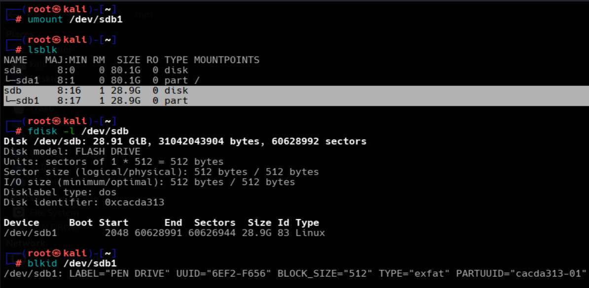

# PART A: GPT PARTITION TABLE

## 4. Creating a GPT Partition Table

Open the USB drive with `fdisk`:

```bash
sudo fdisk /dev/sdb
```

Inside `fdisk`, use the following commands.

| Command | Purpose |
|---|---|
| `p` | Display the current partition table |
| `g` | Create a new GPT partition table |
| `n` | Create a new partition |
| `w` | Save changes and exit |
| `q` | Exit without saving changes |
| `m` | Display help |

Create a new GPT partition table:

```text
g
```

Create the first partition:

```text
n
```

Use partition number `1`, accept the default first sector, and enter `+15G` for the last sector.

Create the second partition:

```text
n
```

Use partition number `2` and accept the default values to use the remaining space.

Display the new partition table:

```text
p
```

Save the changes:

```text
w
```

Verify the new partitions:

```bash
lsblk -f
```

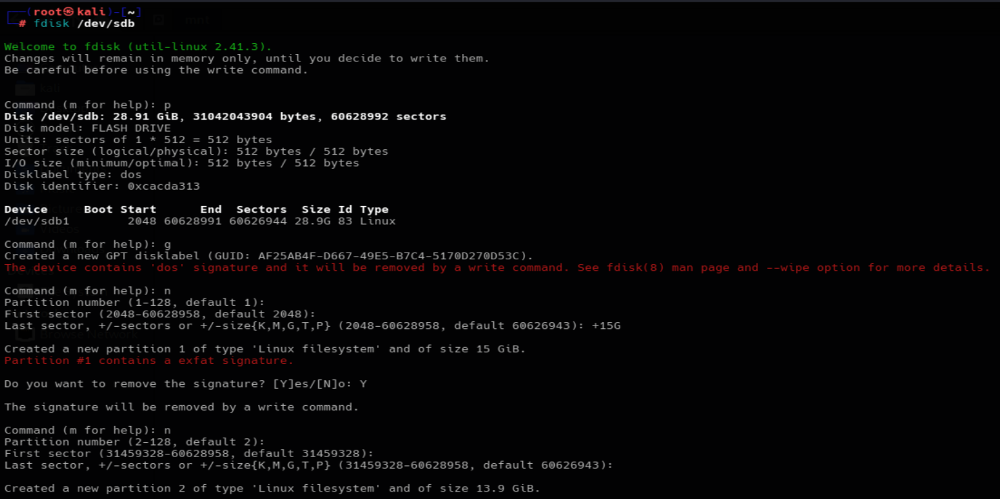
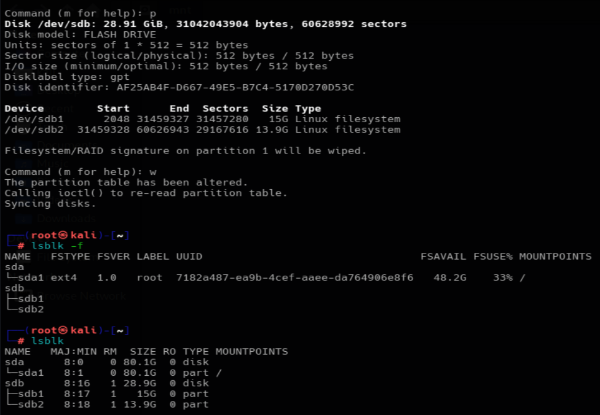
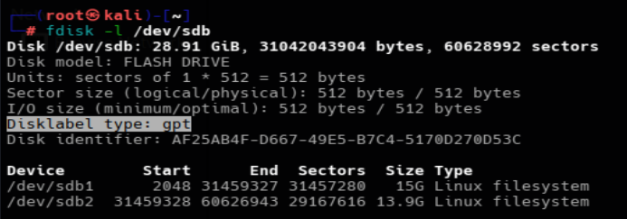

## 5. Formatting the GPT Partitions with mkfs
The `mkfs` commands create a filesystem on a partition. Formatting removes the existing data on the selected partition.

### 5.1 Formatting Partition 1 with ext4

Format the first partition as ext4:

```bash
sudo mkfs.ext4 -L usb-parti1 /dev/sdb1
```
Here `-L` stands for partition label so i gave it usb-parti1, short for usb-partition1.

Check the filesystem information:

```bash
lsblk -f
```

You can also use:

```bash
sudo blkid /dev/sdb1
```
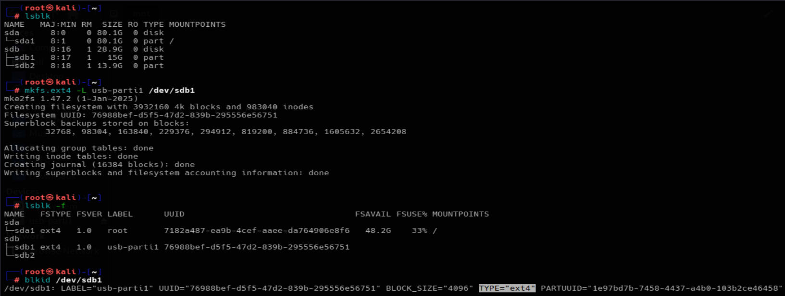

### 5.2 Checking the ext4 Filesystem
Make sure the partition is unmounted before checking it:

Run a read only filesystem check:

```bash
sudo e2fsck -fn /dev/sdb1 "The e2fsck is for ext4 filesystem check"
sudo fsck.ext4 -n /dev/sdb1
```
The `-f` option forces a check and `-n` answers no to repair questions, preventing changes.
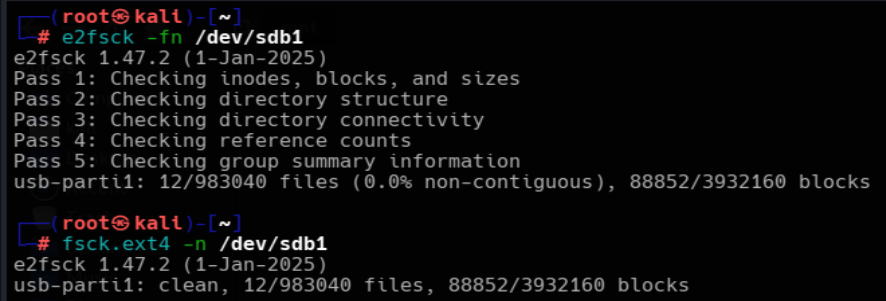

### 5.3 Formatting Partition 2 with exFAT
Format the second partition as exFAT:

```bash
sudo mkfs.exfat -L usb-parti2 /dev/sdb2
```
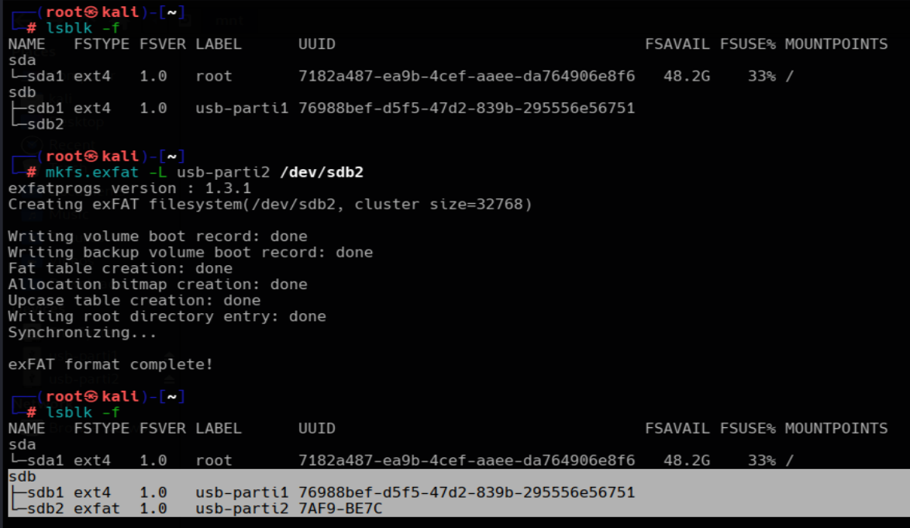

### 5.4 Checking the exFAT Filesystem

Make sure the partition is unmounted:

Run a read only filesystem check:

```bash
sudo fsck.exfat -n /dev/sdb2
```
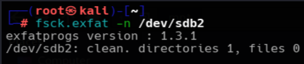

**NOTE: There are several types of partition format i.e vfat,NTFS,FAT 32 etc. We can format our disk partitions with anyone of them according to our needs. In this implementation I used the ext4, exfat and NFTS partition formatting.**

## 8. Mounting the GPT Partitions
Mounting makes a filesystem accessible through a directory.

Create mount point directories:

```bash
sudo mkdir -p /mnt/linux_usb
sudo mkdir -p /mnt/exfat_usb
```

Mount the ext4 partition:

```bash
sudo mount /dev/sdb1 /mnt/mnt-Point1
```

Mount the second partition. I will mount the second partition as read-only(ro) for practice purposes as u can see in the screenshot below.

```bash
sudo mount -o ro /dev/sdb2 /mnt/mnt-Point2
```
Here `ro` means read-only.

Check the mounted filesystems:

```bash
findmnt
```
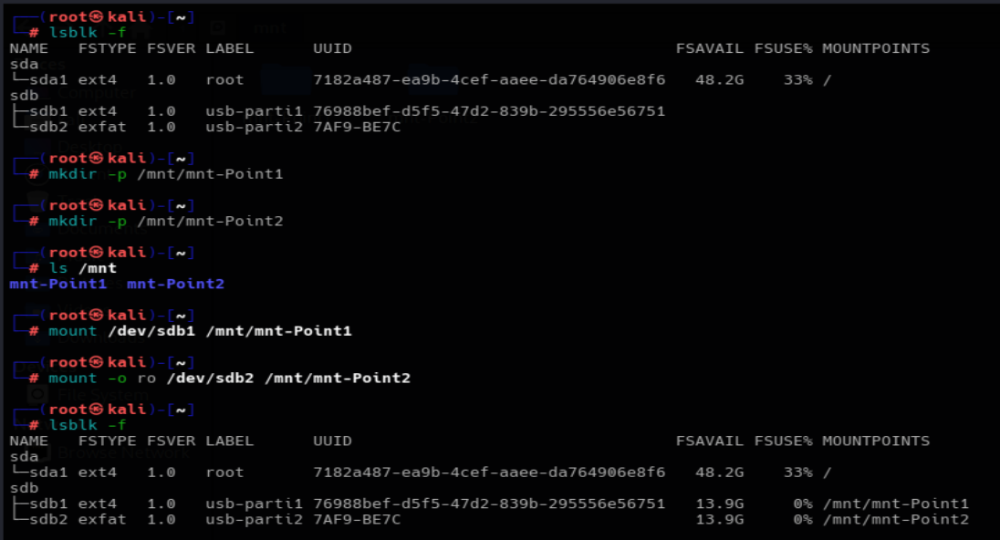
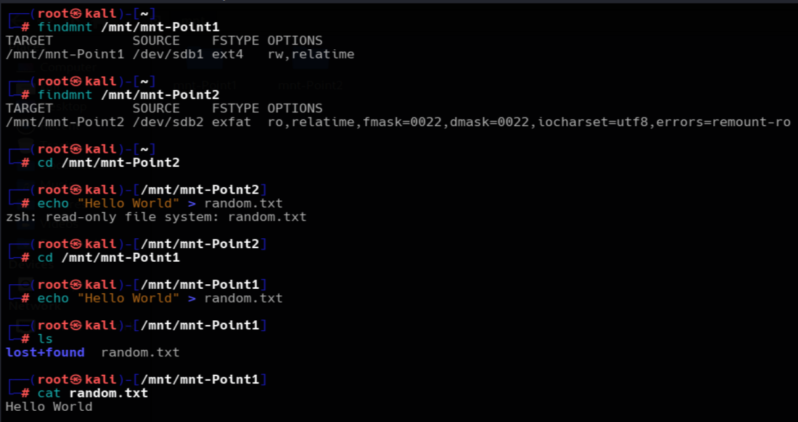

## 9. Unmounting the GPT Partitions

Before removing the USB, finish all operations and flush pending writes:

```bash
sync
```

Unmount the partitions:

```bash
sudo umount /dev/sdb1   
sudo umount /dev/sdb2 

"or we can also unmount using the mount point"
sudo umount /mnt/mnt-Point1
sudo umount /mnt/mnt-Point2
```
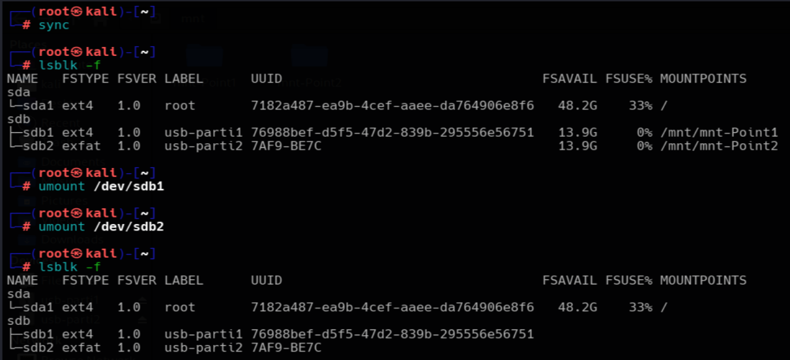

# PART B: DOS OR MBR PARTITION TABLE

## 10. Creating a DOS Partition Table
The DOS partition table is also known as MBR. It is an older partition table format.

Make sure all USB partitions are unmounted before continuing:

Open the USB drive with fdisk:

```bash
sudo fdisk /dev/sdb
```

Inside `fdisk`, create a DOS partition table:

```text
o
```

Create the first primary partition:

```text
n
```

Choose `p` for primary, select partition number `1`, and accept the default first sector. Enter `+15G` for the last sector if the USB/Disk has enough space.

Create the second primary partition:

```text
n
```

Choose `p` for primary, select partition number `2`, and accept the default values to use the remaining space.

Display the partition table:

```text
p
```

Save the changes:

```text
w
```

Display detailed information:

```bash
sudo fdisk -l /dev/sdb
```
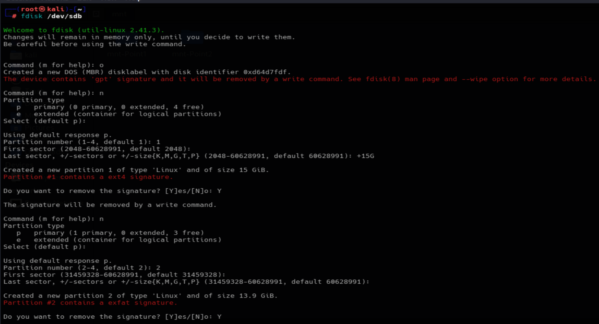
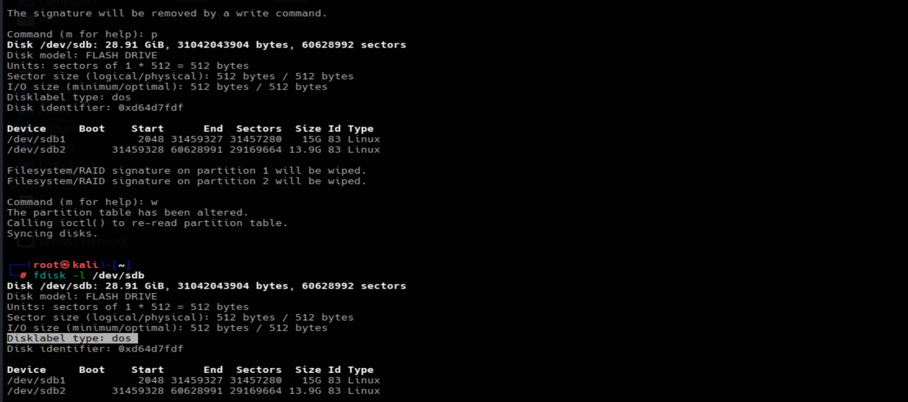

## 11. Formatting the DOS Partitions
The formatting commands are the same for GPT and DOS partitions. The partition table type does not change the `mkfs` command.

### 11.1 Formatting Partition 1 with exfat

```bash
sudo mkfs.exfat -L usb-Parti1 /dev/sdb1
```

Check the filesystem:

```bash
lsblk -f
```

### 11.2 Checking extfat filesystem
Make sure the partition is not mounted while checking.
```bash
sudo fsck.exfat -n /dev/sdb1
```
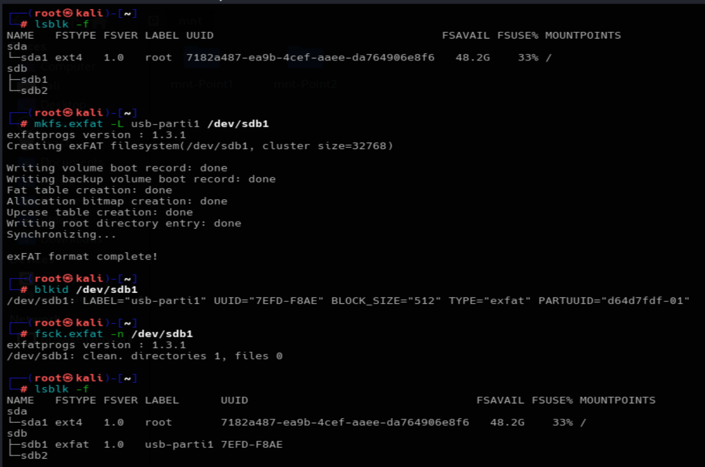

### 11.3 Formatting Partition 2 with NTFS

```bash
sudo mkfs.nfts -f -L usb-parti2 /dev/sdb2
```
Here the `-f` means fast formatting.

Checking NTFS filesystem:

Make sure the partition is not mounted while checking

```bash
sudo ntfsfix -n /dev/sdb2
```
Here the `-n` option performs a check without making changes.
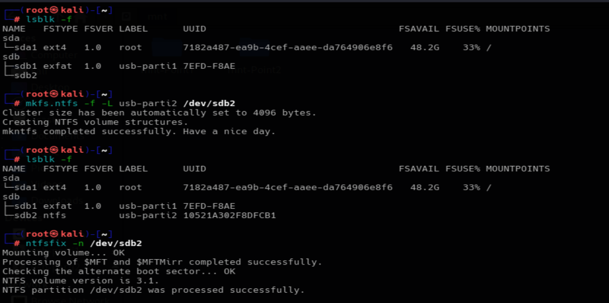

## 12. Mounting the DOS Partitions

Create mount point directories if they do not already exist:

```bash
sudo mkdir -p /mnt/mnt-Point1
sudo mkdir -p /mnt/mnt-Point2
```

Mount partition 1. I will mount this first partition as read-only(ro). Read-only means we will just be able to view/read its content. We'll not be allowed to modifications or changes.

```bash
sudo mount -o ro /dev/sdb1 /mnt/mnt-Point1
```

Mount partition 2. This one will be mounted normally (rw). Means we will be able to read and modify its content.

```bash
sudo mount /dev/sdb2 /mnt/mnt-Point2
```

Check the mounted filesystems:

```bash
findmnt
```
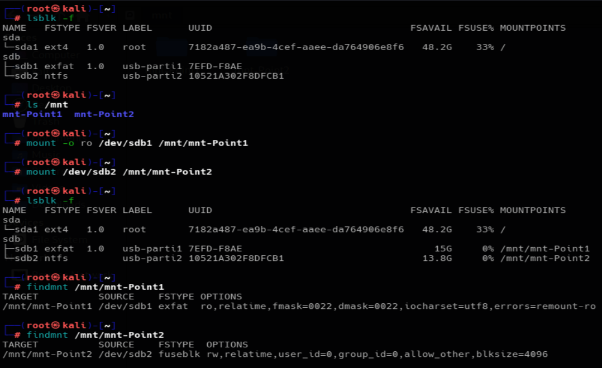

Confirming that the first partition(/dev/sdb1) is read-only mounted.
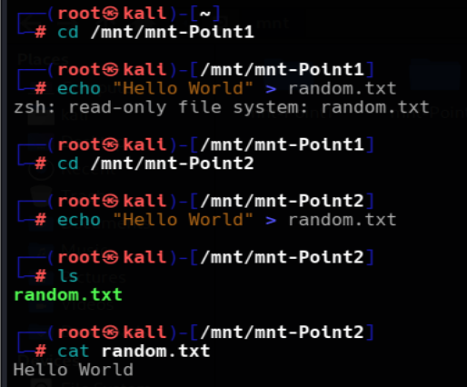

## 13. Unmounting the DOS Partitions
Flush pending writes:
```bash
sync
```

Unmount both partitions:

```bash
sudo umount /mnt/mnnt-Point1
sudo umount /mnt/mnnt-Point2

"or we can also unmount using the specific partitions"
sudo umount /dev/sdb1
sudo umount /dev/sdb2
```

Verify that the partitions are no longer mounted:

```bash
findmnt
```
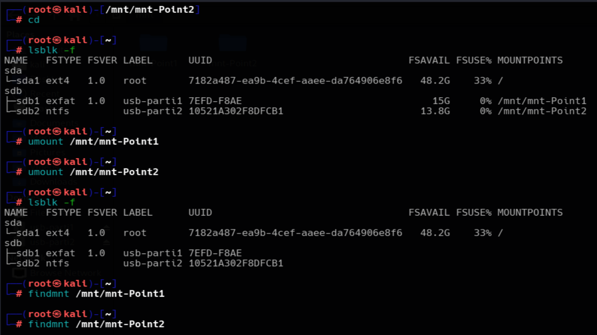

## 14. Useful Commands Summary

| Command | Purpose |
|---|---|
| `lsblk` | Display storage devices and partitions |
| `lsblk -f` | Display filesystem information |
| `fdisk -l` | Display partition table information |
| `fdisk /dev/sdb` | Open a disk for partition management |
| `blkid` | Display filesystem identifiers |
| `mkfs.ext4` | Create an ext4 filesystem |
| `mkfs.exfat` | Create an exFAT filesystem |
| `mkfs.vfat -F 32` | Create a FAT32 filesystem |
| `mkfs.ntfs` | Create an NTFS filesystem |
| `e2fsck` | Check an ext filesystem |
| `fsck.exfat` | Check an exFAT filesystem |
| `fsck.vfat` | Check a FAT filesystem |
| `ntfsfix` | Perform limited NTFS checks and repairs |
| `mount` | Attach a filesystem to a directory |
| `umount` | Detach a mounted filesystem |
| `findmnt` | Display mounted filesystems |
| `df -hT` | Display filesystem type and space usage |
| `sync` | Flush pending filesystem writes |   
