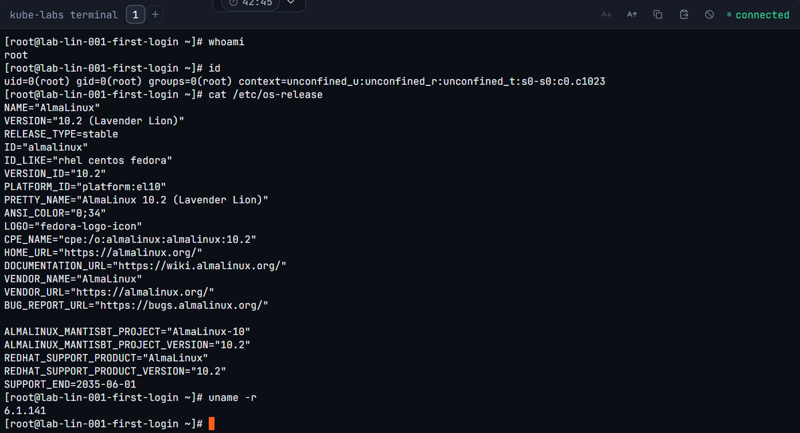
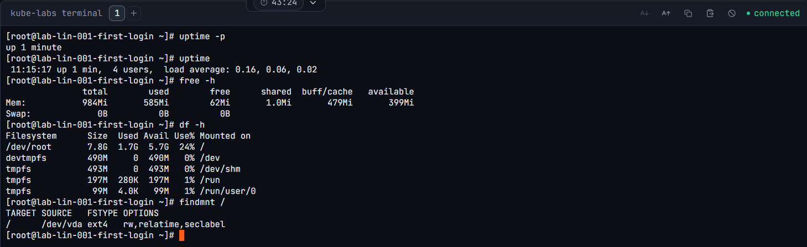
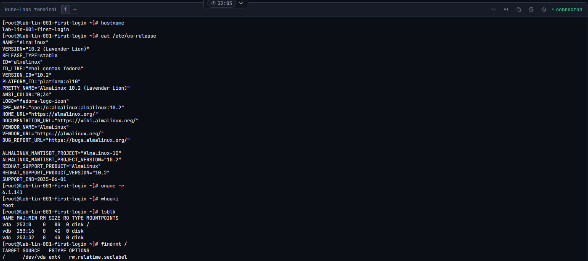
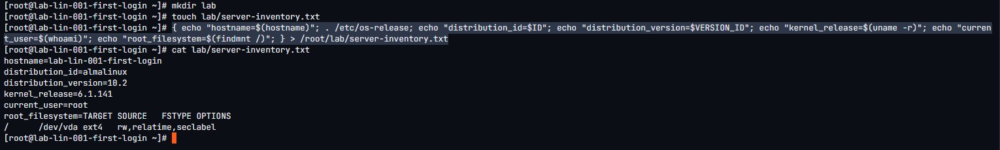
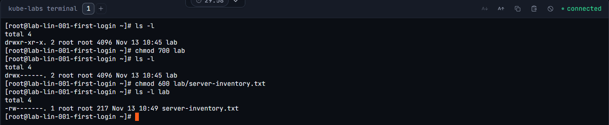
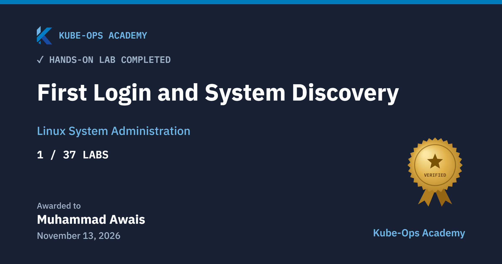

# Lesson 01: First Login and System Discovery
*Maintained by Muhammad Awais*
## 1. Overview

In this lesson, I explored an undocumented Linux server to identify its system information, check available resources, inspect the root filesystem, and create a secure handover note for the next administrator.

- **Platform:** Kube-Ops Academy
- **Track:** Linux System Administration
- **Lesson:** 01 / 37
- **Difficulty:** Beginner
- **Duration:** Approximately 20 minutes
- **Date:** 13-11-2026

## 2. Learning Objectives

By completing this lesson, I learned how to:

- Identify the current user, hostname, Linux distribution, and kernel release.
- Check system uptime, memory usage, and root filesystem capacity.
- Identify the device and filesystem type mounted at `/`.
- Create a server inventory file and secure it using Linux permissions.

## 3. Lab Environment

- **Operating System:** AlmaLinux 10.2 (Lavender Lion)
- **Access Method:** Browser-based terminal and IDE
- **User Account:** root
- **Tools Used:** `whoami`, `id`, `hostname`, `cat`, `uname`, `man`, `uptime`, `free`, `df`, `findmnt`, `mkdir`, `chmod`, `chown`, `ls`

## 4. Practical Tasks

### Task 1: Identifying the System

**Objective:** Identify the logged-in user, hostname, Linux distribution, and running kernel.

**Commands Used:**

```bash
whoami
id
hostname
cat /etc/os-release
uname -r
man uname
```

**Explanation:**

- `whoami` displays the current logged-in username.
- `id` displays the user's numeric UID, primary GID, and group memberships.
- `hostname` displays the machine's hostname.
- `cat /etc/os-release` displays distribution information, including its ID and version.
- `uname -r` displays the running kernel release.
- `man uname` opens the manual page to explore available command options.

**Important Concept:**

The Linux distribution and kernel are different components. The distribution identifies the operating system's userland, while the kernel is the core that manages hardware and system resources.



### Task 2: Checking System Resources

**Objective:** Inspect system uptime, available memory, and root filesystem capacity.

**Commands Used:**

```bash
uptime
free -h
df -h /
findmnt /
```

**Explanation:**

- `uptime` displays how long the system has been running.
- `free -h` displays memory usage in a human-readable format, including available memory.
- `df -h /` displays the capacity and usage of the root filesystem.
- `findmnt /` identifies the source device and filesystem type mounted at `/`.

**Important Concept:**

Memory marked as available is a useful estimate of how much memory can be provided to new applications without requiring swapping.

The root filesystem's source device and filesystem type are separate pieces of information. Both are important when performing disk administration tasks.

**Screenshot:**

 

### Task 3: Identifying the Root Filesystem Type

**Objective:** Determine the filesystem type used by the root filesystem `/`.

**Command Used:**

```bash
findmnt /
```

**Explanation:**

The `findmnt` command displays mounted filesystems and their details. By inspecting the entry for `/`, I identified:

- **Source Device:** [Actual device path]
- **Filesystem Type:** [Actual filesystem type]

**Result:**

The filesystem type of the root filesystem was identified as **[filesystem type]**.



### Task 4: Creating the Server Inventory

**Objective:** Create a server inventory file containing the system information collected during the previous tasks.

**File Location:**

```text
/root/lab/server-inventory.txt
```

**Commands Used:**

```bash
mkdir -p /root/lab
nano /root/lab/server-inventory.txt
cat /root/lab/server-inventory.txt
```

**Explanation:**

- `mkdir -p /root/lab` creates the lab directory.
- `nano` opens a text editor to create and edit the inventory file.
- `cat` displays the file contents for verification.

**Inventory File Format:**

```text
hostname=actual_hostname
distribution_id=actual_distribution_id
distribution_version=actual_version_id
kernel_release=actual_kernel_release
current_user=root
root_filesystem=actual_device_path
```

Each value must match the information reported by the machine. In particular, `distribution_version` must contain the complete `VERSION_ID`, and `root_filesystem` must contain the device path rather than the filesystem type.



### Task 5: Securing the Inventory File

**Objective:** Restrict access to the inventory file and its directory so that only the owner (root) can access them.

**Commands Used:**

```bash
ls -ld /root/lab
ls -l /root/lab/server-inventory.txt

chmod 700 /root/lab
chmod 600 /root/lab/server-inventory.txt

ls -ld /root/lab
ls -l /root/lab/server-inventory.txt
```

**Explanation:**

- `ls -ld` displays the directory's permissions and ownership.
- `ls -l` displays the file's permissions and ownership.
- `chmod 700` gives the directory owner read, write, and execute permissions, removing access from group and others.
- `chmod 600` gives the file owner read and write permissions, removing access from group and others.

**Expected Permissions:**

| Item | Permission | Meaning |
|---|---|---|
| `/root/lab` | `700` | Only the owner can list and enter the directory. |
| `server-inventory.txt` | `600` | Only the owner can read and modify the file. |

The inventory file must remain owned by `root`.



## 5. Verification

The lab requirements were verified by checking that:

- The correct system information was identified.
- The root filesystem's source device and type were determined.
- `/root/lab/server-inventory.txt` contained all six required fields with the exact machine values.
- The inventory file was owned by root and had `600` permissions.
- The `/root/lab` directory had `700` permissions.

## 6. Key Takeaways

- The Linux distribution and kernel are separate components and must be identified independently.
- Commands such as `uptime`, `free`, and `df` help administrators understand system resource availability.
- `findmnt` helps identify filesystem mount sources and types.
- Manual pages are useful for discovering command options.
- Linux permissions help protect sensitive system information from unauthorized access.

## 7. Achievement

Successfully completed **First Login and System Discovery** on Kube-Ops Academy.



## 8. References

- [Kube-Ops Academy – First Login and System Discovery](https://academy.kube-ops.com/courses/6c3bb7d0-ba0f-407f-a86f-52766b4198b2/lessons/553f87a5-6c3f-4744-a910-16ad471c2a01)
- `man uname` – Linux manual page for the `uname` command.
- `man chmod` – Linux manual page for file permissions.