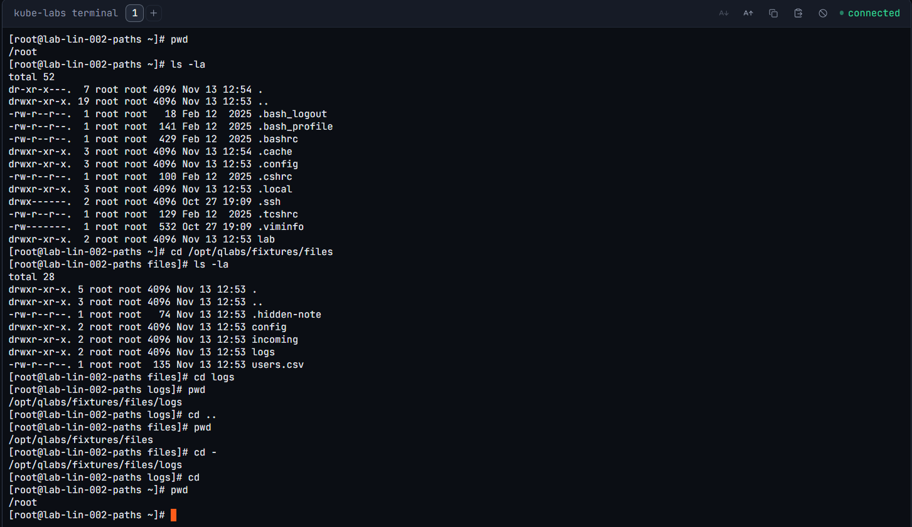
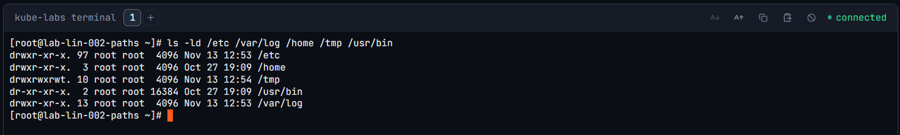
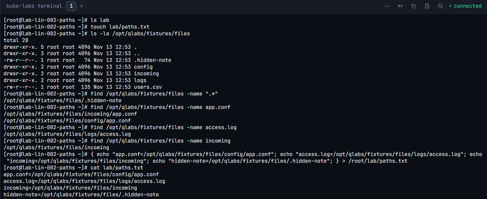
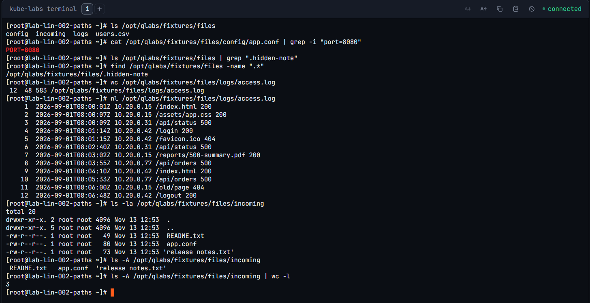
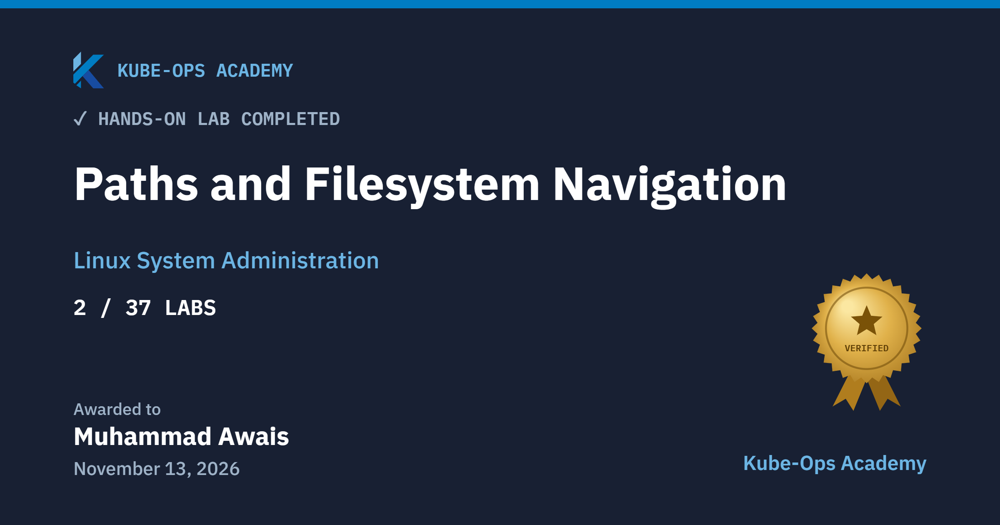

# Lesson 02: Paths and Filesystem Navigation
*Maintained by Muhammad Awais*
## 1. Overview

In this lesson, I practised navigating the Linux filesystem using absolute and relative paths, inspecting system directory permissions, identifying hidden files, and recording verified file locations in a path list.

- **Platform:** Kube-Ops Academy
- **Track:** Linux System Administration
- **Lesson:** 02 / 37
- **Difficulty:** Beginner
- **Duration:** Approximately 20 minutes
- **Date:** 13-11-2026

## 2. Learning Objectives

By completing this lesson, I aimed to understand how to:

- Navigate directories using absolute and relative paths.
- Identify the current working directory and list hidden entries.
- Inspect directory permissions, ownership, and group information.
- Identify the special permission applied to `/tmp`.
- Resolve absolute paths and verify that they point to existing objects.
- Create a path list containing verified filesystem locations.

## 3. Lab Environment

- **Operating System:** AlmaLinux 10.2 (Lavender Lion)
- **Access Method:** Browser-based terminal and IDE
- **User Account:** root
- **Tools Used:** `pwd`, `ls`, `cd`, `stat`, `find`, `realpath`, `mkdir`, `nano`, `cat`, `test`, `wc`

## 4. Practical Tasks

### Task 1: Navigating Directories and Finding Hidden Files

**Objective:** Identify the current working directory, display hidden entries, and practice navigating using absolute and relative paths.

**Commands Used:**

```bash
pwd
ls -la

cd /opt/qlabs/fixtures/files
pwd

cd logs
pwd

cd ..
pwd

cd -
cd
pwd
```

**Explanation:**

- `pwd` displays the current working directory.
- `ls -la` lists all entries, including hidden files, along with detailed information. It also displays `.` and `..`.
- `cd /opt/qlabs/fixtures/files` navigates using an absolute path starting from `/`.
- `cd logs` moves into the `logs` directory using a relative path.
- `cd ..` moves one directory level up.
- `cd -` returns to the previous working directory.
- `cd` without arguments takes the user to their home directory.

**Important Concepts:**

- **Absolute Path:** A complete path that starts from the root directory `/`.
- **Relative Path:** A path interpreted from the current working directory.
- **Hidden Files:** Linux entries beginning with a dot (`.`). They are displayed using `ls -a`.
- `.` represents the current directory, while `..` represents its parent directory.



### Task 2: Inspecting System Directories Without Modifying Them

**Objective:** Inspect the permissions, ownership, and group of important Linux system directories without changing their contents or permissions.

The directories inspected were:

- `/etc`
- `/var/log`
- `/home`
- `/tmp`
- `/usr/bin`

**Commands Used:**

```bash
ls -ld /etc /var/log /home /tmp /usr/bin
```

To display permissions in octal format:

```bash
stat -c '%A %a %U %G %n' /etc /var/log /home /tmp /usr/bin
```

**Explanation:**

- `ls -ld` displays information about the directories themselves rather than listing their contents.
- `stat` displays detailed information about filesystem objects.
- `%A` displays permissions in symbolic form.
- `%a` displays permissions in octal form.
- `%U` displays the owner.
- `%G` displays the group.
- `%n` displays the object name.

**Important Concept:**

These directories have different purposes:

| Directory | Purpose |
|---|---|
| `/etc` | System-wide configuration files |
| `/var/log` | System and application log files |
| `/home` | Users' home directories |
| `/tmp` | Temporary files |
| `/usr/bin` | Common executable programs |

The task was read-only: I inspected these directories without modifying them.



### Task 3: Identifying the Permission Mode of `/tmp`

**Objective:** Identify the exact permission mode of `/tmp`, including its special permission bit.

**Commands Used:**

```bash
ls -ld /tmp
```

**Explanation:**

- `ls -ld /tmp` displays its permissions in symbolic form.
- The special permission bit on `/tmp` is the **Sticky Bit**.

**Important Concept: Sticky Bit**

The sticky bit is commonly used on shared directories such as `/tmp`. It allows users to create files in the directory, but prevents ordinary users from deleting or renaming files belonging to other users.

A common permission mode for `/tmp` is `1777`:

- `1` represents the sticky bit.
- `777` gives read, write, and execute permissions to the owner, group, and others.

**Observed Permission Mode:** `drwxrwxrwt.`

### Task 4: Creating the Absolute Path List

**Objective:** Create `/root/lab/paths.txt` containing the absolute paths of four required objects in the fixture directory.

The required objects were:

1. Application configuration: `config/app.conf`
2. Access log: `logs/access.log`
3. `incoming` directory
4. Hidden note in the top-level fixture directory

**Commands Used:**

```bash
ls /opt/qlabs/fixtures/files

realpath config/app.conf
realpath logs/access.log
realpath incoming
```

After identifying the hidden note's actual name, resolve its path:

```bash
realpath ./hidden-note
```

Created the paths.txt

**Expected File Format:**

```text
app.conf=/opt/qlabs/fixtures/files/config/app.conf
access.log=/opt/qlabs/fixtures/files/logs/access.log
incoming=/opt/qlabs/fixtures/files/incoming
hidden-note=find /opt/qlabs/fixtures/.hidden-note
```

**Explanation:**

- `find` searches for hidden files in the top-level fixture directory.
- `realpath` resolves a path into its absolute form.

Each line must contain the actual absolute path of its corresponding object. Relative paths such as `./` and `../` must not appear in the file.



### Task 5: Verifying the Fixture Tree Remains Unchanged

**Objective:** Confirm that the original fixture files and directories were not modified during the read-only navigation and inspection tasks.

**Commands Used:**

```bash
cat /opt/qlabs/fixtures/files/config/app.conf | grep -i "port=8080"

find /opt/qlabs/fixtures/files -name '.*'

nl /opt/qlabs/fixtures/files/logs/access.log

ls -A /opt/qlabs/fixtures/files/incoming | wc -l
```

**Explanation:**

- `grep -i` checks whether the exact line `PORT=8080` exists in the configuration file.
- `find` checks that the hidden note is still present.
- `wc -l` counts the lines in `access.log`.
- `find` combined with `wc -l` counts entries inside `incoming`, including hidden entries.

**Expected Verification Results:**

| Check | Expected Result |
|---|---|
| Configuration file | Contains `PORT=8080` |
| Hidden note | Still exists |
| `access.log` | 12 lines |
| `incoming` directory | 3 entries, including hidden entries |



## 5. Verification

The lab requirements were verified by checking that:

- Absolute and relative directory navigation worked correctly.
- Hidden entries were visible using `ls -la`.
- System directory permissions and ownership were inspected without changing them.
- The permission mode of `/tmp` was identified, including its sticky bit.
- `paths.txt` contained all four required absolute paths.
- Every recorded path resolved to an existing object from a different working directory.
- The original fixture files and directories retained their required contents.

## 6. Key Takeaways

- Absolute paths begin at `/`, while relative paths depend on the current working directory.
- `pwd` helps identify where you are before executing filesystem commands.
- Hidden files can be displayed using `ls -a`.
- `ls -ld` and `stat` help inspect directory permissions and ownership without modifying them.
- The sticky bit helps protect files in shared directories such as `/tmp`.
- `realpath` helps resolve paths into absolute locations.
- Verifying files after read-only operations is a useful system administration habit.

## 7. Achievement

Successfully completed **Paths and Filesystem Navigation** on Kube-Ops Academy.



## 8. References

- [Kube-Ops Academy – Paths and Filesystem Navigation](https://academy.kube-ops.com/courses/6c3bb7d0-ba0f-407f-a86f-52766b4198b2/lessons/08538990-5d8d-4947-9999-c8afa782c4d0)
- `man ls` – Linux manual page for the `ls` command.
- `man stat` – Linux manual page for the `stat` command.
- `man find` – Linux manual page for the `find` command.
- `man realpath` – Linux manual page for the `realpath` command.