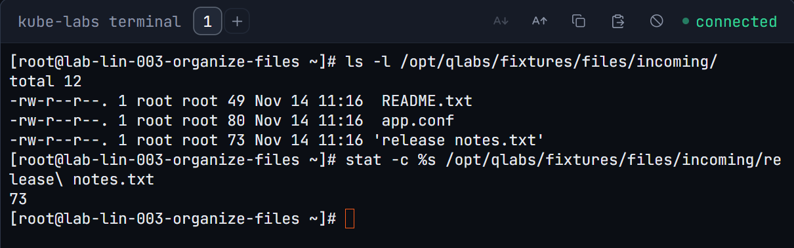
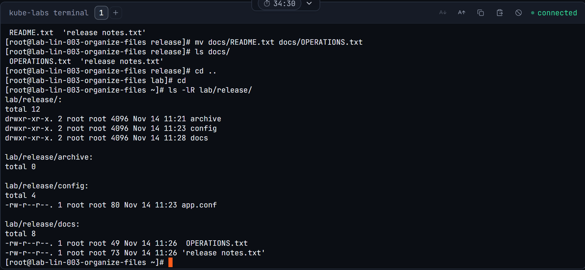
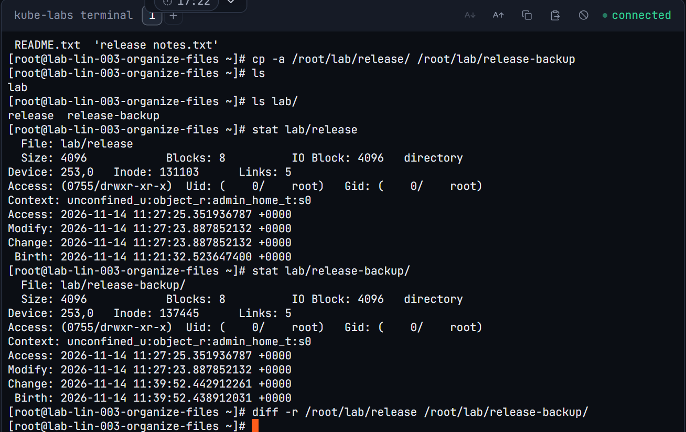
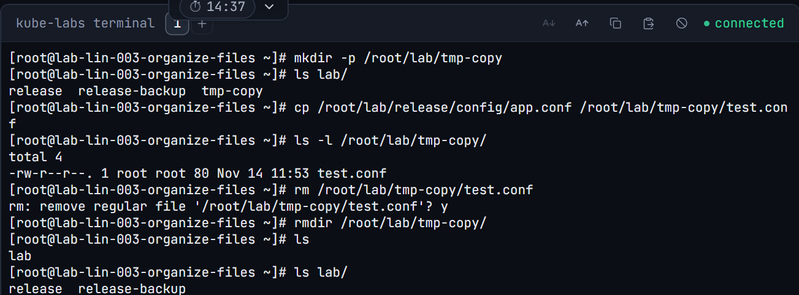
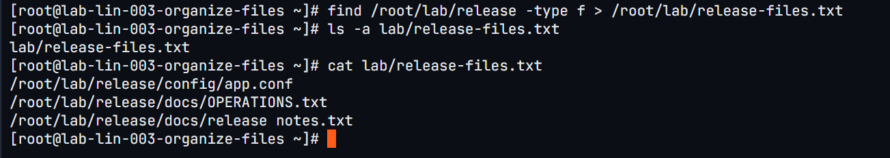
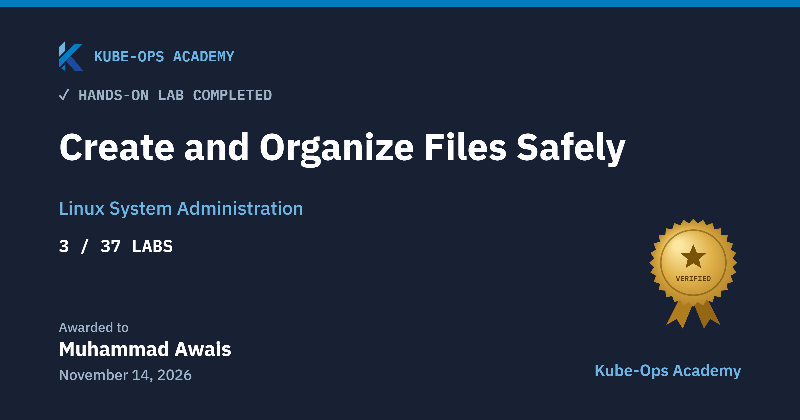

# Lesson 03: Create and Organize Files Safely
*Maintained by Muhammad Awais*
## 1. Overview

In this lesson, I practised managing files and directories in Linux. I learned how to handle filenames containing spaces, create a release directory structure, copy files without changing their contents, preserve metadata during backups, and safely remove temporary files.

- **Platform:** Kube-Ops Academy
- **Track:** Linux System Administration
- **Lesson:** 03 / 37
- **Difficulty:** Beginner
- **Date:** 14-11-2026

## 2. Learning Objectives

By completing this lesson, I aimed to understand how to:

- Measure file sizes, including files with spaces in their names.
- Create directories and copy files into specific locations.
- Rename files while copying them.
- Create backups while preserving file metadata and modification times.
- Safely create and remove temporary directories and files.
- Generate a list of regular files within a directory.
- Verify that original files remain unchanged after copying.

## 3. Lab Environment

- **Operating System:** AlmaLinux 10.2 (Lavender Lion)
- **Access Method:** Browser-based terminal and IDE
- **User Account:** root
- **Tools Used:** `mkdir`, `cp`, `ls`, `cat`, `cmp`, `find(-type)`, `rm`, `rmdir`

## 4. Practical Tasks

### Task 1: Measuring a File with a Space in Its Name

**Objective:** Find the exact size in bytes of `release notes.txt` inside the inbox directory.

**Command Used:**

```bash
ls -l /opt/qlabs/fixtures/files/incoming/
stat -c %s /opt/qlabs/fixtures/files/incoming/release\ notes.txt
```

**Explanation:**

- `ls -l` lists files with long listing including permissions, size, owner, group, timstamps etc
- `stat` Displays detailed information about a file, such as: size, owner, group, permissions etc. `-c`Stands for format (format control). It allows you to specify exactly which information you want stat to display. `%s` is a format specifier that means file size in bytes.

**Result:**

The file size was **73 bytes**.



### Task 2: Building the Release Directory Structure

**Objective:** Create a release workspace containing the required directories and copies of the inbox files, while keeping the original files untouched.

**Commands Used:**

```bash
mkdir -p /root/lab/release/{config,docs,archive}

cp /opt/qlabs/fixtures/files/incoming/app.conf /root/lab/release/config/

cd /opt/qlabs/fixtures/files/incoming

cp README.txt "release notes.txt" /root/lab/release/docs/

mv /docs/README.txt /docs/OPERATIONS.txt

ls -lR /root/lab/release/
```

**Explanation:**

- `mkdir -p` creates the release directory and its required subdirectories.
- `cp` copies files from the inbox into the release workspace.
- Quotation marks protect filenames containing spaces.
- The final `mv` command renames `README.txt` under the new name `OPERATIONS.txt`.

**Important Concept:**

Copying creates a separate file at the destination. The original inbox files remain in their original locations.

The task requires copying `README.txt` under a new name, not leaving a `README.txt` inside the `docs` directory.



### Task 3: Creating a Backup of the Release Tree

**Objective:** Create a faithful backup of the release directory while preserving file contents, permissions, ownership, timestamps, and other relevant metadata.

**Command Used:**

```bash
cp -a /root/lab/release /root/lab/release-backup
```

**Explanation:**

- `cp` copies files and directories.
- `-a` enables archive mode.
- Archive mode preserves important file attributes, including permissions, ownership, timestamps, and symbolic links.

The backup should contain the same directory structure and files as the original release directory.

**Verification Commands:**

```bash
stat /root/lab/release/
stat /root/lab/release-backup/

diff -r /root/lab/release /root/lab/release-backup
```

**Important Concept:**

A backup should preserve more than just file contents. Metadata such as modification timestamps and permissions can also be important when restoring files.



### Task 4: Creating and Removing a Scratch Directory

**Objective:** Create a temporary directory, copy and inspect a configuration file, and then safely remove only the temporary files.

**Commands Used:**

```bash
mkdir -p /root/lab/tmp-copy

cp /root/lab/release/config/app.conf /root/lab/tmp-copy/test.conf

ls -l /root/lab/tmp-copy/

rm /root/lab/tmp-copy/test.conf

rmdir /root/lab/tmp-copy
```

**Explanation:**

- `mkdir -p` creates the temporary directory.
- `cp` creates a test copy of the configuration file.
- `ls -l` displays the copied file's details.
- `cat` displays its contents.
- `rm` removes the temporary file.
- `rmdir` removes an empty directory.

**Important Safety Concept:**

Commands such as `rm -r` and `rm -f` can permanently remove files and directories. Always check the exact path before deleting anything. We can also use `rm -i` which confirms(yes/no) before removing anything.

In this task, only `/root/lab/tmp-copy` and its test file should be removed. The original release directory and its backup must survive.



### Task 5: Creating a File List and Verifying the Originals

**Objective:** Generate a list of every regular file inside the release directory and confirm that the original inbox files remain unchanged.

**Commands Used:**

```bash
find /root/lab/release -type f > /root/lab/release-files.txt

cat /root/lab/release-files.txt
```

**Explanation:**

- `find` searches for files and directories.
- `-type f` selects regular files only.
- `>` redirects the results into `release-files.txt`.
- `cat` displays the generated file list.

The three original inbox files must remain present and unchanged. The release-files.txt contains only paths of the regular.



## 5. Verification

The lab requirements were verified by checking that:

- The size of `release notes.txt` was correctly identified as 73 bytes.
- The release directory contained `config`, `docs`, and `archive`.
- All three required files were copied to their correct locations.
- `README.txt` was copied as `OPERATIONS.txt`.
- The release backup contained the same files and preserved their metadata.
- The temporary directory and its test copy were removed.
- The original release and backup directories remained intact.
- `release-files.txt` contained the paths of all regular files.
- The three original inbox files remained unchanged.

## 6. Key Takeaways

- Quotation marks are important when working with filenames containing spaces.
- `mkdir -p` makes it easier to create nested directory structures.
- `cp` creates copies without modifying the source files.
- `cp -a` helps preserve important metadata during backups.
- Temporary files and directories should be removed carefully.
- `find -type f` can generate a list of regular files.
- `cmp` helps verify whether two files have identical contents.

## 7. Achievement

Successfully completed **Create and Organize Files Safely** on Kube-Ops Academy.



## 8. References

- [Kube-Ops Academy – Create and Organize Files Safely ](https://academy.kube-ops.com/en/labs/linux/create-and-organize-files-safely)
- `man wc` – Linux manual page for counting file information.
- `man mkdir` – Linux manual page for creating directories.
- `man cp` – Linux manual page for copying files and directories.
- `man find` – Linux manual page for searching files.
- `man cmp` – Linux manual page for comparing files.
- `man rm` – Linux manual page for removing files and directories.