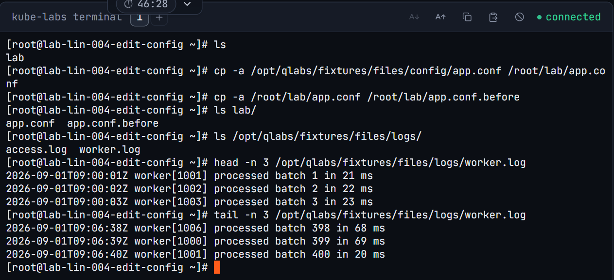
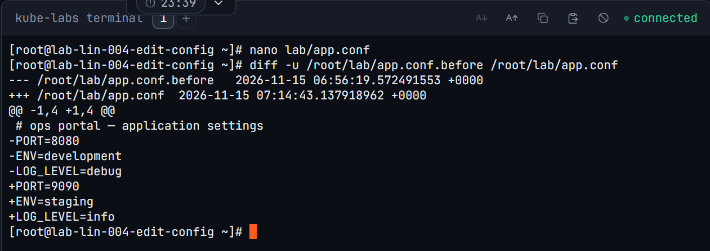
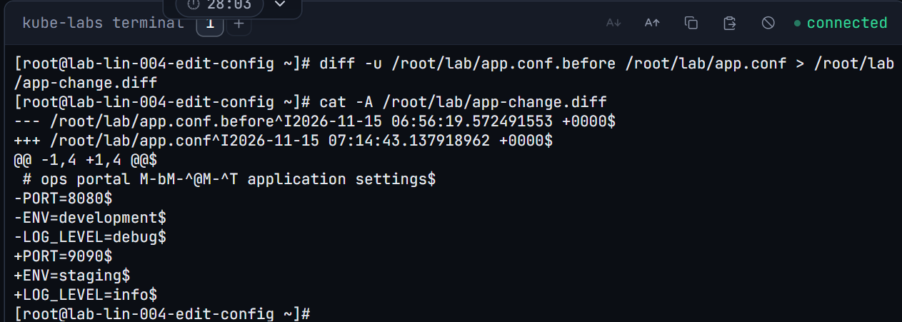
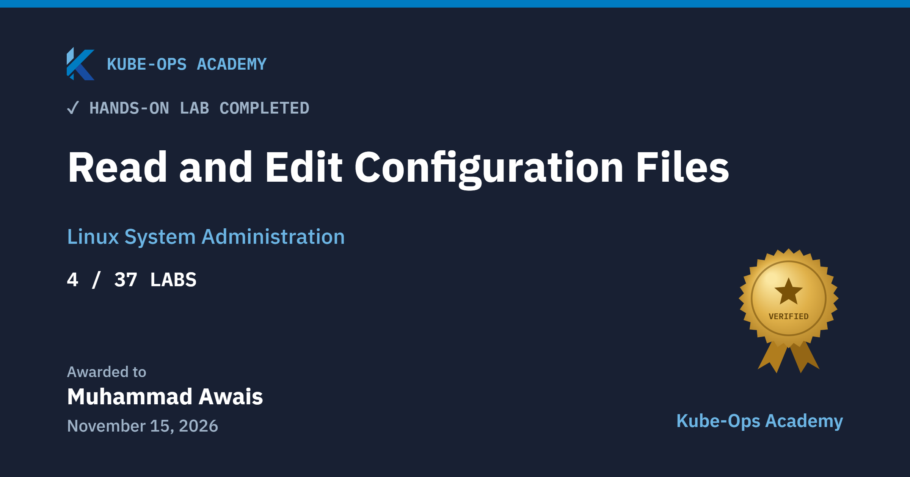

# Lesson 04: Read and Edit Configuration Files
*Maintained by Muhammad Awais*

## 1. Overview

In this lesson, I practised reading, editing, and comparing Linux configuration files. I learned how to inspect long log files, create separate working and backup copies, modify specific configuration settings without changing anything else, and generate a unified diff to verify the changes.

- **Platform:** Kube-Ops Academy
- **Track:** Linux System Administration
- **Lesson:** 04 / 37
- **Difficulty:** Beginner
- **Date:** 15-11-2026

## 2. Learning Objectives

By completing this lesson, I aimed to understand how to:

- Read complete files using `cat`.
- Inspect long files using `less`, `head`, and `tail`.
- Count the total number of lines in a file.
- Create separate working and original backup copies.
- Edit specific configuration settings using `vi` or `nano`.
- Preserve the original file while making changes.
- Generate unified diffs to document file modifications.
- Understand the exit statuses returned by the `diff` command.

## 3. Lab Environment

- **Operating System:** AlmaLinux 10.2 (Lavender Lion)
- **Access Method:** Browser-based terminal and IDE
- **User Account:** root
- **Tools Used:** `cat`, `less`, `head`, `tail`, `wc`, `cp`, `mkdir`, `vi`, `nano`, `diff`

## 4. Practical Tasks

### Task 1: Creating Copies and Reading Configuration Files

**Objective:** Create a working copy and an untouched backup of the original configuration file. Then inspect the configuration and practise reading a long log file.

**Source Configuration:**

```bash
/opt/qlabs/fixtures/files/config/app.conf
```

**Source Log File:**

```bash
/opt/qlabs/fixtures/files/logs/worker.log
```

**Commands Used:**

```bash

cp -a /opt/qlabs/fixtures/files/config/app.conf /root/lab/app.conf

cp -a /root/lab/app.conf /root/lab/app.conf.before
```

Read the working configuration:

```bash
cat /root/lab/app.conf
```

Display the first three lines of the log:

```bash
head -n 3 /opt/qlabs/fixtures/files/logs/worker.log
```

Display the last three lines:

```bash
tail -n 3 /opt/qlabs/fixtures/files/logs/worker.log
```

**Explanation:**

- `cp` creates copies of the original configuration file.
- `app.conf` is the working copy that can be edited.
- `app.conf.before` is the untouched backup used for comparison.
- `cat` displays the complete contents of a file.
- `head -n 3` displays only the first three lines.
- `tail -n 3` displays only the last three lines.

**Important Concept:**

Always keep an untouched copy of the original configuration before editing. This allows you to compare the original and modified versions later.



### Task 2: Counting the Lines of a Long Log

**Objective:** Determine the total number of lines in `worker.log`.

**Command Used:**

```bash
wc -l /opt/qlabs/fixtures/files/logs/worker.log
```

**Explanation:**

- `wc` stands for word count. It can count lines, words, and bytes.
- `-l` tells the command to count lines only.
- The file path specifies which file should be counted.

**Result:**

The log file contained **400 lines**.

**Important Concept:**

Before inspecting a large file, knowing its total line count can help you understand its size and choose an appropriate way to read it.

### Task 3: Editing Three Configuration Values

**Objective:** Update three settings in the working configuration file without modifying the original backup or changing any unrelated content.

**Command Used:**
```bash
nano /root/lab/app.conf

vi /root/lab/app.conf

diff -u /root/lab/app.conf.before /root/lab/app.conf
```
**Required Changes:**

| Setting | Original Value | Updated Value |
|---|---|---|
| PORT | 8080 | 9090 |
| ENV | development | staging |
| LOG_LEVEL | debug | info |

**Final Configuration:**

```ini
# ops portal
PORT=9090
ENV=staging
LOG_LEVEL=info
```

**Explanation:**

- `vi` is a terminal-based text editor used to modify files.
- `nano` is another terminal-based editor with simpler keyboard controls.
- The working copy `/root/lab/app.conf` was edited instead of the original fixture.
- `diff -u` is used to see the unified format difference between the two files.
- Each existing setting was updated in place rather than adding duplicate configuration entries.

**Important Concept:**

Configuration files often contain important application settings. Changing only the required values helps prevent accidental modifications to unrelated configurations.

The comment line must remain unchanged, and each configuration key must appear exactly once.



### Task 4: Generating a Unified Diff

**Objective:** Compare the untouched backup with the edited configuration and save the differences in a separate file.

**Command Used:**

```bash
diff -u /root/lab/app.conf.before /root/lab/app.conf > /root/lab/app-change.diff
```

Display the generated diff:

```bash
cat -A /root/lab/app-change.diff
```

**Explanation:**

- `diff` compares the contents of two files.
- `-u` generates the output in unified format.
- The first file is the original backup.
- The second file is the modified working copy.
- `>` redirects the comparison output into `app-change.diff`.

**Understanding Unified Diff Symbols:**

- `---` identifies the original file.
- `+++` identifies the updated file.
- `-` represents a line removed from the original version.
- `+` represents a line added in the updated version.

**Important Concept:**

A unified diff provides a readable record of exactly what changed between two files. It is useful for reviewing configuration changes and maintaining a history of modifications.



## 5. Verification

The lab requirements were verified by checking that:

- The working configuration and untouched backup were created successfully.
- The complete configuration file was read using `cat`.
- The first and last three lines of `worker.log` were displayed.
- The log file contained exactly 400 lines.
- The working configuration contained the updated values:
  - `PORT=9090`
  - `ENV=staging`
  - `LOG_LEVEL=info`
- Each configuration key appeared exactly once.
- The original comment line remained unchanged.
- The configuration retained four non-empty lines.
- The original backup remained identical to the original fixture.
- The unified diff contained the `---` and `+++` headers.
- The diff showed exactly three removed and three added setting lines.
- The original fixture still contained `PORT=8080`.

## 6. Key Takeaways

- `cat` is useful for reading complete files.
- `less` provides an interactive way to inspect long files.
- `head` and `tail` display the beginning and end of files.
- `wc -l` counts the total number of lines.
- Always preserve an untouched backup before modifying configuration files.
- `vi` and `nano` allow editing files directly from the terminal.
- `diff -u` generates a readable record of file modifications.
- An exit status of `1` from `diff` indicates that differences were found.

## 7. Achievement

Successfully completed **Read and Edit Configuration Files** on Kube-Ops Academy.



## 8. References

- [Kube-Ops Academy – Read and Edit Configuration Files](https://academy.kube-ops.com/en/labs/linux/read-and-edit-configuration-files)
- `man cat` – Linux manual page for displaying file contents.
- `man less` – Linux manual page for viewing files interactively.
- `man head` – Linux manual page for displaying the beginning of files.
- `man tail` – Linux manual page for displaying the end of files.
- `man wc` – Linux manual page for counting lines, words, and bytes.
- `man cp` – Linux manual page for copying files.
- `man vi` – Linux manual page for the vi editor.
- `man diff` – Linux manual page for comparing files.