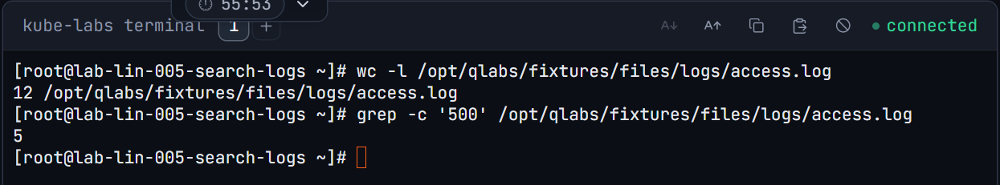
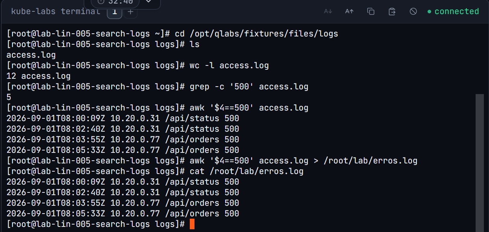
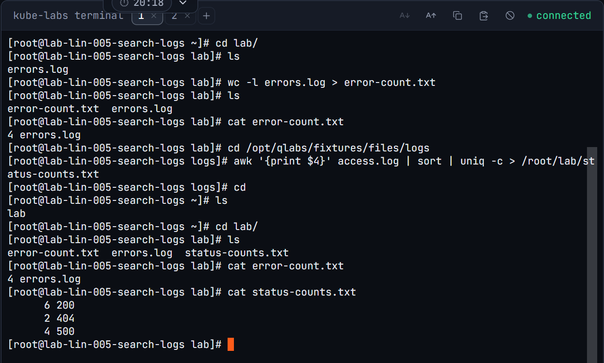
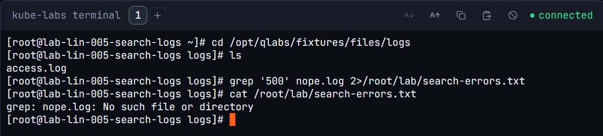
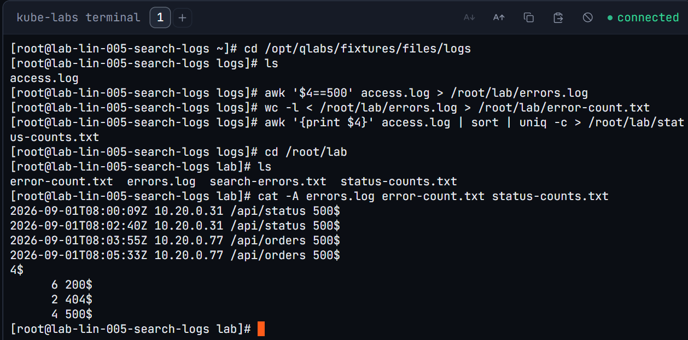

# Lesson 05: Search Logs and Build Pipelines
*Maintained by Muhammad Awais*

## 1. Overview

This lesson focuses on searching Linux log files, extracting specific records using `awk`, counting and summarising results with pipelines, and managing standard output and standard error through redirection.

It also demonstrates why choosing the correct output redirection operator matters when regenerating reports.

- **Platform:** Kube-Ops Academy
- **Track:** Linux System Administration
- **Lesson:** 05 / 37
- **Difficulty:** Beginner
- **Date:** 16-11-2026

## 2. Learning Objectives

- Understand the structure of log files before searching them.
- Search for specific values using `grep`.
- Extract records by column using `awk`.
- Combine `sort` and `uniq` to generate summaries.
- Count lines using `wc`.
- Understand standard output (stdout) and standard error (stderr).
- Use `>` and `>>` correctly when generating report files.

## 3. Lab Environment

- **Operating System:** AlmaLinux 10.2 (Lavender Lion)
- **Access Method:** Browser-based terminal and IDE
- **User Account:** root
- **Tools Used:** `grep`, `awk`, `sort`, `uniq`, `wc`, `cat`, shell redirection

## 4. Practical Tasks

### Task 1: Count the Naive Matches

**Objective:**

Find how many lines in the portal's access log contain the text `500` anywhere in the line.

**Log File:**

`/opt/qlabs/fixtures/files/logs/access.log`

**Commands Used:**

```bash
grep 500 /opt/qlabs/fixtures/files/logs/access.log
grep -c 500 /opt/qlabs/fixtures/files/logs/access.log
```

**Explanation:**

- `grep` searches for a specific text pattern in a file.
- `500` is the text being searched for.
- `-c` counts the matching lines instead of displaying them.
- The search returns five matching lines.

**Important Concept:**

A text search does not understand the meaning of a log column. One successful request contains `500` in its URL (`/reports/500-summary.pdf`) but has an HTTP status of `200`.

Therefore, searching for `500` anywhere in a line gives five matches, even though there are only four failed requests.



### Task 2: Extract the Failed Requests

**Objective:**

Extract only the requests whose HTTP status column is `500` and save the complete original lines into `/root/lab/errors.log`.

**Command Used:**

```bash
awk '$4 == 500' /opt/qlabs/fixtures/files/logs/access.log > /root/lab/errors.log
```

**Explanation:**

- `awk` processes text using fields (columns).
- `$4` represents the fourth column.
- `==` checks whether two values are equal.
- `500` is the status code we want to match.
- `$0` represents the entire original line. Because no custom print action is specified, `awk` prints the complete matching lines by default.
- `>` redirects the output into `errors.log`.

**Important Concept:**

Unlike `grep`, which searches for text anywhere in a line, `awk` allows us to check a specific column.

The result contains exactly four failed requests. The successful request containing `500` in its URL is excluded.



### Task 3: Count and Summarise

**Objective:**

Generate two reports:

1. `error-count.txt` — contains only the number of failed requests.
2. `status-counts.txt` — contains the number of requests for each distinct HTTP status code.

**Commands Used:**

**A. Count failed requests**

```bash
wc -l < /root/lab/errors.log > /root/lab/error-count.txt
```

**B. Summarise HTTP status codes**

```bash
awk '{print $4}' /opt/qlabs/fixtures/files/logs/access.log | sort | uniq -c > /root/lab/status-counts.txt
```

**Explanation:**

**A. Understanding `wc -l`:**

- `wc` counts lines, words, and characters.
- `-l` tells it to count lines.
- `<` redirects the file's contents into the command as standard input.
- This input-redirection method prevents `wc` from displaying the filename in its output.
- `>` saves only the resulting count into the report.

**B. Understanding the pipeline:**

This command uses three tools connected through pipes:

1. `awk '{print $4}'` extracts only the fourth column (HTTP status code).
2. `sort` arranges the status codes so identical values appear next to each other.
3. `uniq -c` counts consecutive duplicate lines and displays each count beside its status code.

**Expected Report:**

```text
6 200
2 404
4 500
```

**Important Concept:**

A pipe (`|`) sends the standard output of one command to the standard input of the next command.

`sort` is important because `uniq` only groups consecutive identical lines. Sorting first makes sure identical status codes are together.



### Task 4: Keep Errors Out of the Report

**Objective:**

Search for `500` in a nonexistent log file and save the resulting error message into `/root/lab/search-errors.txt`.

**Commands Used:**

```bash
grep 500 /opt/qlabs/fixtures/files/logs/nope.log 2> /root/lab/search-errors.txt
```

**Explanation:**

Linux processes normally use three standard streams:

| Stream | File Descriptor | Purpose |
|---|---:|---|
| stdin | 0 | Input received by a command |
| stdout | 1 | Normal command output |
| stderr | 2 | Error messages and complaints |

- `2>` redirects only standard error (file descriptor 2).
- The missing file causes `grep` to produce a `No such file or directory` error.
- The error message is saved in `search-errors.txt`.

**Important Concept:**

The expected exit status is `2`, which means `grep` encountered an error.

For `grep`, an exit status of `0` means a match was found, `1` means no match was found, and `2` indicates an error.

Redirecting stderr separately helps distinguish an actual search result from a command failure.



### Task 5: Rerun Without Doubling the Report

**Objective:**

Regenerate all three reports without adding duplicate content. Each new run must replace the previous report contents.

**Commands Used:**

```bash
awk '$4 == 500' /opt/qlabs/fixtures/files/logs/access.log > /root/lab/errors.log

wc -l < /root/lab/errors.log > /root/lab/error-count.txt

awk '{print $4}' /opt/qlabs/fixtures/files/logs/access.log | sort | uniq -c > /root/lab/status-counts.txt
```

**Explanation:**

The same commands are executed again, but the important point is the use of `>`.

- `>` creates a file if it does not exist and replaces its existing contents if it does.
- `>>` appends new content to the end of an existing file.

For reports that are regenerated regularly, using `>` prevents old results from being mixed with new results.



## 5. Verification

The following commands can be used to verify the generated reports:

```bash
wc -l /root/lab/errors.log
cat /root/lab/error-count.txt
cat /root/lab/status-counts.txt
wc -l /root/lab/status-counts.txt
cat /root/lab/search-errors.txt
```

**Expected Results:**

| File | Expected Content |
|---|---|
| `errors.log` | 4 complete failed-request records |
| `error-count.txt` | `4` only |
| `status-counts.txt` | 3 status-count lines |
| `search-errors.txt` | Error message from the failed search |

## 6. Key Takeaways

- `grep` searches for text, but it does not understand log columns.
- `awk` can extract or filter records using specific fields.
- `$4` represents the fourth field, while `$0` represents the complete line.
- `sort` arranges data, making it easier for `uniq` to count repeated values.
- `wc -l` counts lines.
- A pipe (`|`) passes output between commands.
- Standard output and standard error are separate streams.
- `2>` redirects error messages separately.
- `$?` displays the previous command's exit status.
- `>` replaces existing content, while `>>` appends content.

## 7. Achievement

Successfully completed the lesson by extracting failed HTTP requests, generating status-code reports, handling error output separately, and regenerating reports without duplicating their contents.


## 8. References

- [GNU Grep Manual](https://www.gnu.org/software/grep/manual/grep.html)
- [GNU Awk User's Guide](https://www.gnu.org/software/gawk/manual/)
- [GNU Coreutils Manual](https://www.gnu.org/software/coreutils/manual/)
- [Linux Manual Pages – awk](https://man7.org/linux/man-pages/man1/awk.1.html)
- [Linux Manual Pages – grep](https://man7.org/linux/man-pages/man1/grep.1.html)