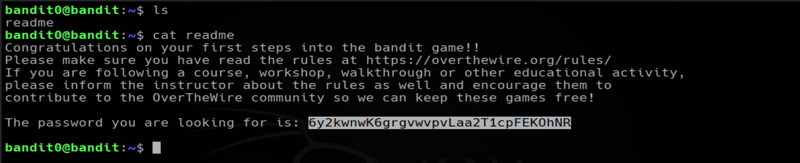

# Bandit Level 0 → Level 1
*Maintained by Muhammad Awais*
## 1. Overview

This level introduces basic Linux file navigation and file reading. The objective is to locate the `readme` file in the home directory, read its contents, and use the retrieved password to access the next level.

- **Platform:** OverTheWire Bandit
- **Level:** 0 → 1
- **Difficulty:** Beginner
- **Operating System:** Kali GNU/Linux 2026.3 (VM)
- **Connection:** SSH (Port 2220)

## 2. Goal

Find the password for Bandit Level 1 stored inside a file named `readme` in the home directory of `bandit0`.

## 3. Approach

1. Connected to the Bandit server as `bandit0` using SSH.
2. Listed the contents of the home directory to locate the `readme` file.
3. Used `cat` to display the file contents.
4. Retrieved the password required to access `bandit1`.
5. Used the password to establish an SSH connection as `bandit1`.

## 4. Commands Used

```bash
ls
cat readme
```

Connect to the next level:

```bash
ssh bandit1@bandit.labs.overthewire.org -p 2220
```

## 5. Explanation

- `ls`: Lists files and directories in the current directory. It helps identify the `readme` file.
- `cat readme`: Displays the contents of the `readme` file, which contains the password for the next level.
- `ssh`: Establishes a remote connection to the next Bandit level.
- `-p 2220`: Specifies the SSH port used by the Bandit server.

## 6. Result

Successfully located and read the `readme` file, retrieved the password for `bandit1`, and used it to log in to the next level.



## 7. Key Takeaway

- Learned how to list directory contents using `ls`.
- Practised reading file contents using `cat`.
- Understood how to retrieve credentials from a file.
- Practised moving between remote Bandit levels using SSH.

## Helpful Resources

- [OverTheWire – Bandit Level 1](https://overthewire.org/wargames/bandit/bandit1.html)
- [ls Manual](https://manpages.ubuntu.com/manpages/noble/man1/ls.1.html)
- [cat Manual](https://manpages.ubuntu.com/manpages/noble/man1/cat.1.html)
- [SSH Manual](https://manpages.ubuntu.com/manpages/noble/man1/ssh.1.html)