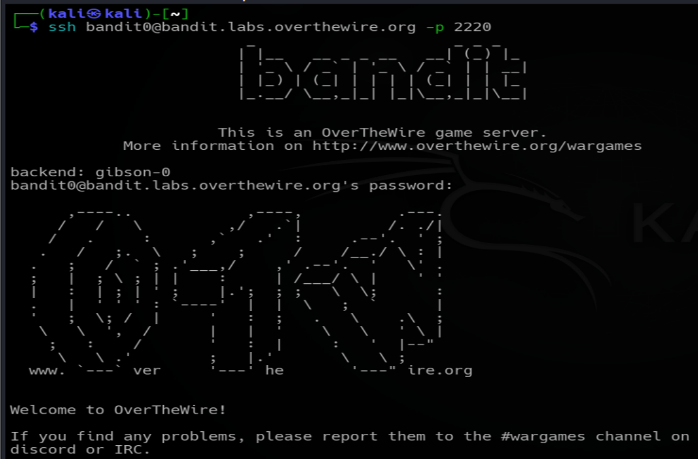

# Bandit Level 00
*Maintained by Muhammad Awais*
## 1. Overview

This level introduces remote access through SSH (Secure Shell). The objective is to connect to the OverTheWire Bandit server using the provided login credentials and a custom SSH port.

- **Platform:** OverTheWire Bandit
- **Level:** 0
- **Difficulty:** Beginner
- **Operating System:** Kali GNU/Linux 2026.3 (VM)  
- **Connection:** SSH (Port 2220)

## 2. Goal

Log in to the Bandit game server using SSH with the provided username and password.

**Connection Details:**

| **Parameter** | **Value** |
|---|---|
| Host | `bandit.labs.overthewire.org` |
| Port | `2220` |
| Username | `bandit0` |
| Protocol | SSH |

## 3. Approach

Used the SSH client from my Linux terminal to establish a remote connection with the Bandit server.

## 4. Command Used

```bash
ssh bandit0@bandit.labs.overthewire.org -p 2220

ls 

cat
```

## 5. Explanation

- `ssh`: Starts the Secure Shell client to connect to a remote system.
- `bandit0`: Specifies the username used for authentication.
- `@`: Separates the username from the remote host.
- `bandit.labs.overthewire.org`: Specifies the server's hostname.
- `-p 2220`: Specifies the SSH port. SSH normally uses port 22, but Bandit uses port 2220.
- `ls` lists content
- `cat` displays file content

After executing the command, enter the provided password when prompted. The terminal does not display characters while typing the password; this is normal SSH security behavior.

## 6. Result

Successfully established an SSH connection to the OverTheWire Bandit server and accessed the `bandit0` remote shell.

The initial connection was completed by finding the password for the next level, allowing me to proceed to the Level 0 → 1 challenge.



## 7. Key Takeaway

- Learned how to connect to a remote Linux server using SSH.
- Understood how to specify a username and remote hostname.
- Learned to connect through a non-default SSH port using `-p`.
- Practised remote authentication through the Linux terminal.

## Helpful Resources

- [OverTheWire – Bandit Level 0](https://overthewire.org/wargames/bandit/bandit0.html)
- [SSH Manual](https://manpages.ubuntu.com/manpages/noble/man1/ssh.1.html)
- [Secure Shell (SSH)](https://en.wikipedia.org/wiki/Secure_Shell)