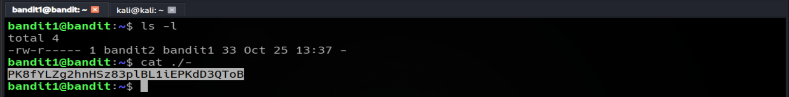

# Bandit Level 1 → Level 2
*Maintained by Muhammad Awais*
## 1. Overview

This level introduces handling files with unusual filenames. The password for the next level is stored in a file named `-` in the home directory. Since the filename begins with a hyphen, it requires special handling when using Linux commands.

- **Platform:** OverTheWire Bandit
- **Level:** 1 → 2
- **Difficulty:** Beginner
- **Operating System:** Kali GNU/Linux 2026.3 (VM)
- **Connection:** SSH (Port 2220)

## 2. Goal

Locate and read the file named `-` in the home directory to retrieve the password for Bandit Level 2.

## 3. Approach

1. Connected to the Bandit server as `bandit1` using SSH.
2. Listed the home directory contents to identify the file named `-`.
3. Used `cat ./-` to read the file.
4. Retrieved the password required to access `bandit2`.

## 4. Commands Used

```bash
ls
cat ./-
```

Connect to the next level:

```bash
ssh bandit2@bandit.labs.overthewire.org -p 2220
```

## 5. Explanation

- `ls`: Lists files and directories in the current directory.
- `cat`: Displays the contents of a file.
- `./-`: Specifies the file named `-` using its relative path.

**Why use `./-` instead of `cat -`?**

A hyphen (`-`) at the beginning of a command argument can be interpreted as an option or special input indicator. By writing `./-`, we explicitly tell the command to access a file named `-` in the current directory.

## 6. Result

Successfully read the file named `-` and retrieved the password required to access Bandit Level 2.



## 7. Key Takeaway

- Learned how to handle filenames beginning with a hyphen.
- Understood why `cat -` can behave differently from `cat ./-`.
- Practised using `./` to reference files in the current directory.
- Learned how `--` separates command options from arguments.

## Helpful Resources

- [OverTheWire – Bandit Level 2](https://overthewire.org/wargames/bandit/bandit2.html)
- [cat Manual](https://manpages.ubuntu.com/manpages/noble/man1/cat.1.html)
- [Bash Special Characters](https://linux.die.net/abs-guide/special-chars.html)
- [Search: Handling Filenames Beginning with a Dash](https://www.google.com/search?q=dashed+filename)