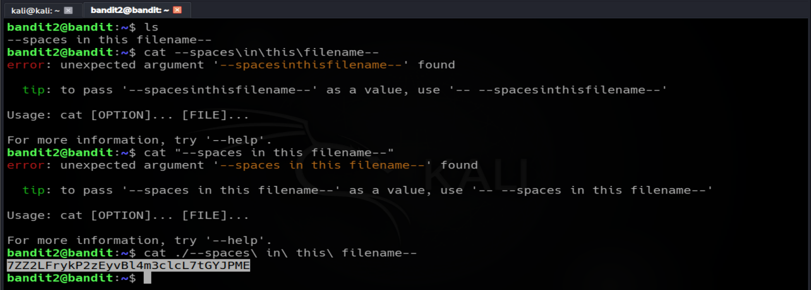

# Bandit Level 2 → Level 3
*Maintained by Muhammad Awais*
## 1. Overview

This level introduces handling filenames that contain spaces. The password for the next level is stored in a file named `--spaces in this filename--` in the home directory. Special care is required when referencing this filename in Linux commands.

- **Platform:** OverTheWire Bandit
- **Level:** 2 → 3
- **Difficulty:** Beginner
- **Operating System:** Kali GNU/Linux 2026.3 (VM)
- **Connection:** SSH (Port 2220)

## 2. Goal

Locate and read the file named `--spaces in this filename--` in the home directory to retrieve the password for Bandit Level 3.

## 3. Approach

1. Connected to the Bandit server as `bandit2` using SSH.
2. Listed the home directory contents to identify the file.
3. Used quotation marks around the filename to handle the spaces correctly.
4. Retrieved the password required to access `bandit3`.

## 4. Commands Used

```bash
ls
cat "--spaces in this filename--"
```

Connect to the next level:

```bash
ssh bandit3@bandit.labs.overthewire.org -p 2220
```

## 5. Explanation

- `ls`: Lists files and directories in the current directory.
- `cat`: Displays the contents of a file.
- `"--spaces in this filename--"`: Quotation marks keep the entire filename together as a single argument.

**Why use quotation marks?**

Normally, the shell treats spaces as separators between command arguments.

For example:

```bash
cat my file.txt
```

The shell interprets this as multiple arguments instead of one filename.

Using quotation marks solves this problem:

```bash
cat "my file.txt"
```

Another way is to escape each space using a backslash (`\`):

```bash
cat --spaces\ in\ this\ filename--
```

Both methods allow Linux commands to work with filenames containing spaces.

## 6. Result

Successfully accessed the file containing spaces in its name and retrieved the password required to access Bandit Level 3.



## 7. Key Takeaway

- Learned how to handle filenames containing spaces.
- Understood how quotation marks group a filename into one argument.
- Practised escaping spaces using a backslash.
- Improved command-line file handling skills.

## Helpful Resources

- [OverTheWire – Bandit Level 3](https://overthewire.org/wargames/bandit/bandit3.html)
- [cat Manual](https://manpages.ubuntu.com/manpages/noble/man1/cat.1.html)
- [Search: Handling Spaces in Filenames](https://www.google.com/search?q=spaces+in+filename)