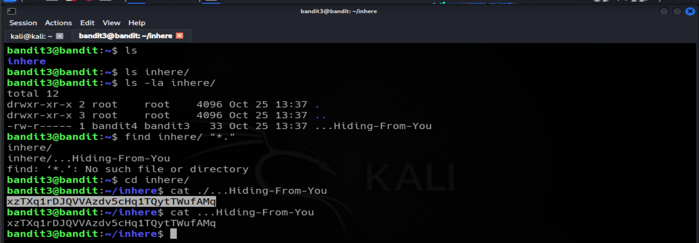

# Bandit Level 3 → Level 4
*Maintained by Muhammad Awais*
## 1. Overview

This level introduces hidden files and how to locate them in Linux. The password for the next level is stored in a hidden file inside the `inhere` directory.

- **Platform:** OverTheWire Bandit
- **Level:** 3 → 4
- **Difficulty:** Beginner
- **Operating System:** Kali GNU/Linux 2026.3 (VM)
- **Connection:** SSH (Port 2220)

## 2. Goal

Find and read the hidden file inside the `inhere` directory to retrieve the password for Bandit Level 4.

## 3. Approach

1. Connected to the Bandit server as `bandit3` using SSH.
2. Listed the home directory contents and located the `inhere` directory.
3. Changed the current directory to `inhere`.
4. Used `ls -la` to display all files, including hidden files.
5. Read the hidden file using `cat` to retrieve the next level's password.

## 4. Commands Used

```bash
ls
cd inhere
ls -la
cat <hidden-filename>
cat ./<hidden-filename>
```

Connect to the next level:

```bash
ssh bandit4@bandit.labs.overthewire.org -p 2220
```

*Replace `<hidden-filename>` with the actual hidden filename discovered in the directory.*

## 5. Explanation

- `ls`: Lists files and directories in the current directory.
- `cd inhere`: Changes the current working directory to `inhere`.
- `ls -la`: Displays all directory entries, including hidden files, along with detailed information.
- `cat`: Displays the contents of the specified file.

**What are hidden files in Linux?**

In Linux, filenames beginning with a dot (`.`) are treated as hidden files.

For example:

```text
.secret
.config
.hiddenfile
```

The normal `ls` command does not display these files.

The `-a` option tells `ls` to display all entries, including hidden files. The `-l` option displays detailed information such as permissions, ownership, size, and modification time.

## 6. Result

Successfully located the hidden file inside the `inhere` directory and retrieved the password required to access Bandit Level 4.



## 7. Key Takeaway

- Learned how Linux identifies hidden files.
- Understood why normal `ls` does not display hidden files.
- Practised using `ls -la` to reveal hidden directory entries.
- Learned to navigate directories and read hidden files.

## Helpful Resources

- [OverTheWire – Bandit Level 4](https://overthewire.org/wargames/bandit/bandit4.html)
- [ls Manual](https://manpages.ubuntu.com/manpages/noble/man1/ls.1.html)
- [cd Manual](https://manpages.ubuntu.com/manpages/noble/man1/cd.1posix.html)
- [cat Manual](https://manpages.ubuntu.com/manpages/noble/man1/cat.1.html)