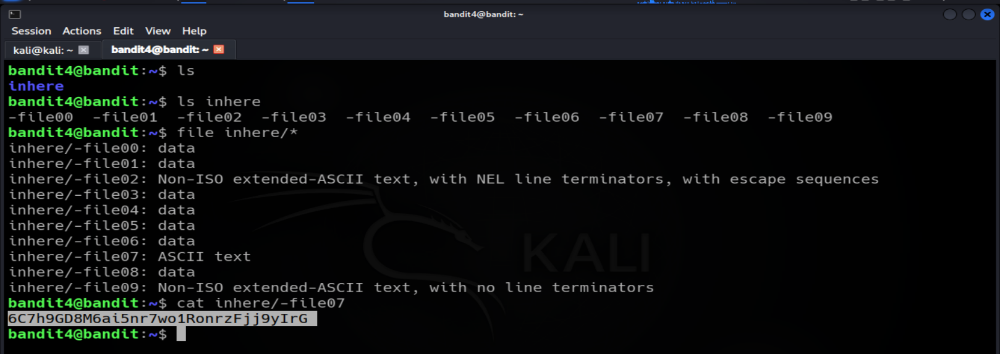

# Bandit Level 4 → Level 5
*Maintained by Muhammad Awais*
## 1. Overview

This level introduces file type identification using the Linux `file` command. The objective is to find the only human-readable file inside the `inhere` directory among multiple files.

- **Platform:** OverTheWire Bandit
- **Level:** 4 → 5
- **Difficulty:** Beginner
- **Operating System:** Kali GNU/Linux 2026.3 (VM)
- **Connection:** SSH (Port 2220)

## 2. Goal

Identify and read the only human-readable file inside the `inhere` directory to retrieve the password for Bandit Level 5.

## 3. Approach

1. Connected to the Bandit server as `bandit4` using SSH.
2. Changed the current directory to `inhere`.
3. Used `file ./*` to identify the types of all files in the directory.
4. Examined the output and identified the only human-readable file.
5. Used `cat` to read that file and retrieve the next level's password.

## 4. Commands Used

```bash
cd inhere
file ./*
cat ./<filename>
```

*Replace `<filename>` with the actual human-readable filename identified from the command output.*

Connect to the next level:

```bash
ssh bandit5@bandit.labs.overthewire.org -p 2220
```

## 5. Explanation

- `cd inhere`: Changes the current working directory to `inhere`.
- `file`: Identifies the type and format of a file.
- `./*`: A shell wildcard pattern that expands to all non-hidden entries in the current directory.
- `cat`: Displays the contents of the selected file.

**How does `file ./*` work?**

The `*` wildcard matches multiple filenames. Before executing the `file` command, the shell expands `./*` into the names of the matching entries.

The `file` command then examines each entry and reports its type.

For example, the output may identify files as ASCII text, binary data, or other file formats.

The human-readable file can be identified from this output because it is reported as ASCII text file only.

## 6. Result

Successfully identified the only human-readable file using `file ./*` and retrieved the password required to access Bandit Level 5.



## 7. Key Takeaway

- Learned how to identify file types using the `file` command.
- Understood how the `*` wildcard matches multiple filenames.
- Practised inspecting multiple files with a single command.
- Learned to distinguish human-readable text files from binary files.

## Helpful Resources

- [OverTheWire – Bandit Level 5](https://overthewire.org/wargames/bandit/bandit5.html)
- [file Manual](https://manpages.ubuntu.com/manpages/noble/man1/file.1.html)
- [Bash Filename Expansion](https://www.gnu.org/software/bash/manual/html_node/Filename-Expansion.html)
