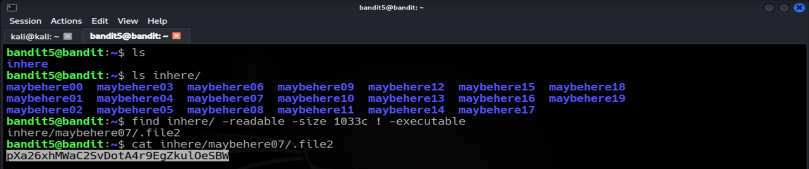

# Bandit Level 5 → Level 6
*Maintained by Muhammad Awais*

## 1. Overview

This level introduces advanced file searching using the Linux `find` command. The objective is to locate a specific file inside the `inhere` directory by matching multiple conditions, including file size, readability, and executable permissions.

- **Platform:** OverTheWire Bandit
- **Level:** 5 → 6
- **Difficulty:** Beginner
- **Operating System:** Kali GNU/Linux 2026.3 (VM)
- **Connection:** SSH (Port 2220)

## 2. Goal

Find the file somewhere under the `inhere` directory that meets all three conditions:

- Human-readable
- Exactly 1033 bytes in size
- Not executable

Read the file to retrieve the password for Bandit Level 6.

## 3. Approach

1. Connected to the Bandit server as `bandit5` using SSH.
2. Listed the home directory and located the `inhere` directory.
3. Inspected the subdirectories inside `inhere`.
4. Used `find` with multiple conditions to locate the required file.
5. Found the matching file at `inhere/maybehere07/.file2`.
6. Used `cat` to display its contents and retrieve the next level's password.

## 4. Commands Used

**List the home directory:**

```bash
ls
```

**List the contents of the inhere directory:**

```bash
ls inhere/
```

**Search for the file matching all required conditions:**

```bash
find inhere/ -readable -size 1033c ! -executable
```

**Read the identified file:**

```bash
cat inhere/maybehere07/.file2
```

Connect to the next level:

```bash
ssh bandit6@bandit.labs.overthewire.org -p 2220
```

## 5. Explanation

### Understanding the find command

The `find` command searches for files and directories based on specified conditions.

In this challenge:

```bash
find inhere/ -readable -size 1033c ! -executable
```

- `find`: Searches for files and directories.
- `inhere/`: Specifies the directory where the search begins.
- `-readable`: Matches files that are readable by the current user.
- `-size 1033c`: Matches files with exactly 1033 bytes. The `c` represents bytes.
- `! -executable`: Excludes files that are executable. The `!` simply means "not".

All conditions are applied together, so the command returns entries matching every requirement.

### Understanding the search result

```text
inhere/maybehere07/.file2
```

This output identifies the file that matches the specified conditions. Its hidden filename begins with a dot, but `find` can locate hidden files without requiring a special option.

## 6. Result

Successfully located the required file using `find` and its multiple search conditions. The file was found at:

`inhere/maybehere07/.file2`

Read its contents using `cat` and retrieved the password required to access Bandit Level 6.



## 7. Key Takeaway

- Learned how to search for files using `find`.
- Practised combining multiple search conditions.
- Understood the `-readable`, `-size`, and `! -executable` options.
- Learned that `find` can locate hidden files inside nested directories.

## Helpful Resources

- [OverTheWire – Bandit Level 6](https://overthewire.org/wargames/bandit/bandit6.html)
- [find Manual](https://manpages.ubuntu.com/manpages/noble/man1/find.1.html)
- [file Manual](https://manpages.ubuntu.com/manpages/noble/man1/file.1.html)