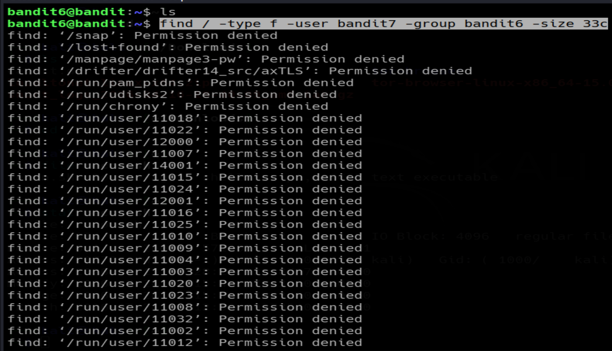
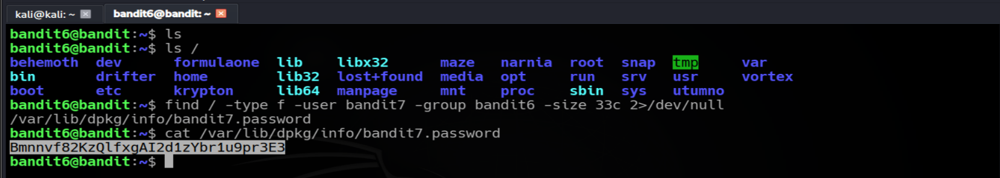

# Bandit Level 6 → Level 7
*Maintained by Muhammad Awais*

## 1. Overview

This level introduces advanced file searching using the Linux `find` command. The objective is to locate a specific file anywhere on the server by matching its file type, ownership, group ownership, and size.

- **Platform:** OverTheWire Bandit
- **Level:** 6 → 7
- **Difficulty:** Beginner
- **Operating System:** Kali GNU/Linux 2026.3 (VM)
- **Connection:** SSH (Port 2220)

## 2. Goal

Find the regular file somewhere on the server that meets all the following conditions:

- Owned by user `bandit7`.
- Owned by group `bandit6`.
- Exactly 33 bytes in size.

Read the matching file to retrieve the password for Bandit Level 7.

## 3. Approach

1. Connected to the Bandit server as `bandit6` using SSH.
2. Used `find` to search the entire filesystem starting from `/`.
3. Restricted the search to regular files using `-type f`.
4. Applied user ownership, group ownership, and file-size conditions.
5. Redirected error messages to `/dev/null` to keep the output clean.
6. Read the matching file using `cat` to retrieve the next level's password.

## 4. Commands Used

**Search the entire filesystem:**

```bash
find / -type f -user bandit7 -group bandit6 -size 33c 2>/dev/null
```

**Read the matching file:**

```bash
cat <file-path>
```

Connect to the next level:

```bash
ssh bandit7@bandit.labs.overthewire.org -p 2220
```

*Replace `<file-path>` with the actual path returned by the `find` command.*

## 5. Explanation

### Understanding the find command

```bash
find / -type f -user bandit7 -group bandit6 -size 33c 2>/dev/null
```

- `find`: Searches for files and directories based on specified conditions.
- `/`: Starts the search from the root directory, allowing the search to cover the entire filesystem.
- `-type f`: Searches for regular files only.
- `-user bandit7`: Matches files owned by user `bandit7`.
- `-group bandit6`: Matches files owned by group `bandit6`.
- `-size 33c`: Matches files exactly 33 bytes in size. The `c` represents bytes.

### Understanding 2>/dev/null

When searching the entire filesystem, `find` may encounter directories that the current user does not have permission to access. This can generate error messages such as:

```text
find: '/some/directory': Permission denied
```

To suppress these messages, the command uses:

```bash
2>/dev/null
```

Breaking it down:

- `2`: Represents standard error (stderr), also known as file descriptor 2.
- `>`: Redirects the output.
- `/dev/null`: A special Linux device that discards anything sent to it.

Therefore, `2>/dev/null` redirects error messages to `/dev/null`, preventing them from appearing in the terminal.

**Important:** This does not hide normal search results. Matching file paths are still displayed because they are sent through standard output (stdout).

## 6. Result

Successfully used `find` to search for regular files matching the required ownership, group ownership, and size conditions. Error messages were suppressed using `2>/dev/null`, keeping the terminal output clean.

Read the matching file to retrieve the password required to access Bandit Level 7.




## 7. Key Takeaway

- Learned how to search the entire filesystem using `find`.
- Practised filtering regular files using `-type f`.
- Understood user and group ownership filters.
- Learned to search for files with an exact size using `-size`.
- Understood standard error redirection using `2>/dev/null`.
- Learned how `/dev/null` discards redirected output.

## Helpful Resources

- [OverTheWire – Bandit Level 7](https://overthewire.org/wargames/bandit/bandit7.html)
- [find Manual](https://manpages.ubuntu.com/manpages/noble/man1/find.1.html)
- [Bash Redirections](https://www.gnu.org/software/bash/manual/html_node/Redirections.html)