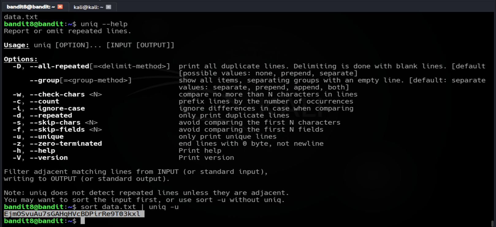

# Bandit Level 8 → Level 9
*Maintained by Muhammad Awais*

## 1. Overview

This level introduces duplicate-line detection in Linux using the `sort` and `uniq` commands. The objective is to identify the only line in a file that occurs exactly once.

- **Platform:** OverTheWire Bandit
- **Level:** 8 → 9
- **Difficulty:** Beginner
- **Operating System:** Kali GNU/Linux 2026.3 (VM)
- **Connection:** SSH (Port 2220)

## 2. Goal

The password for the next level is stored in `data.txt`.

The file contains multiple lines of text, but only one line occurs exactly once. The task is to identify that unique line and retrieve the next level's password.

## 3. Approach

1. Connected to the Bandit server as `bandit8` using SSH.
2. Used `uniq --help` to understand the available options of the `uniq` command.
3. Used `sort` to arrange identical lines next to each other.
4. Used `uniq -u` to display only lines that occur once.
5. Retrieved the password from the unique line.

## 4. Commands Used

**Check the available uniq options:**

```bash
uniq --help
```
This command displays the help information for `uniq`, including its available options and usage.
It is useful when learning a new Linux command because it helps you understand how to use its different features.

**Find the line that occurs only once:**

```bash
sort data.txt | uniq -u
```

Connect to the next level:

```bash
ssh bandit9@bandit.labs.overthewire.org -p 2220
```

## 5. Explanation

### Understanding the uniq Command

`uniq` is a Linux command-line utility used to detect and filter repeated or unique lines in text.

It can identify:
- Repeated lines.
- Lines that occur only once.
- The number of consecutive occurrences of each line.

**Important:** `uniq` only compares adjacent lines. If identical lines are scattered throughout a file, it cannot reliably identify all duplicates unless they are arranged next to each other first.

### Understanding the sort Command

`sort` arranges lines of text in alphabetical or numerical order.

In this level, it is important because it places identical lines next to each other before passing them to `uniq`.

### Breaking Down the Main Command

```bash
sort data.txt | uniq -u
```

- `sort`: Sorts the contents of the file.
- `data.txt`: The file containing multiple lines of text.
- `|`: The pipe operator sends the output of `sort` to the next command.
- `uniq`: Processes adjacent lines and identifies repeated or unique entries.
- `-u`: Displays only lines that occur exactly once.

**Important Concept:**

The combination of `sort` and `uniq -u` is useful when searching for unique entries in large text files. Sorting groups identical lines together, allowing `uniq` to identify which lines occur only once.

## 6. Result

Successfully used `sort` and `uniq -u` to identify the only line that occurs once in `data.txt`.

The unique line contained the password required to access Bandit Level 9.



## 7. Key Takeaway

- Learned how to use `uniq` to identify repeated and unique lines.
- Understood why `uniq` requires identical lines to be adjacent.
- Practised sorting file contents using `sort`.
- Learned how `uniq -u` displays lines occurring exactly once.
- Understood how the pipe operator combines multiple commands.
- Practised using `--help` to explore Linux command options.

## Helpful Resources

- [OverTheWire – Bandit Level 9](https://overthewire.org/wargames/bandit/bandit9.html)
- [Piping and Redirection](https://ryanstutorials.net/linuxtutorial/piping.php)
- [uniq Manual](https://manpages.ubuntu.com/manpages/noble/man1/uniq.1.html)
- [sort Manual](https://manpages.ubuntu.com/manpages/noble/man1/sort.1.html)