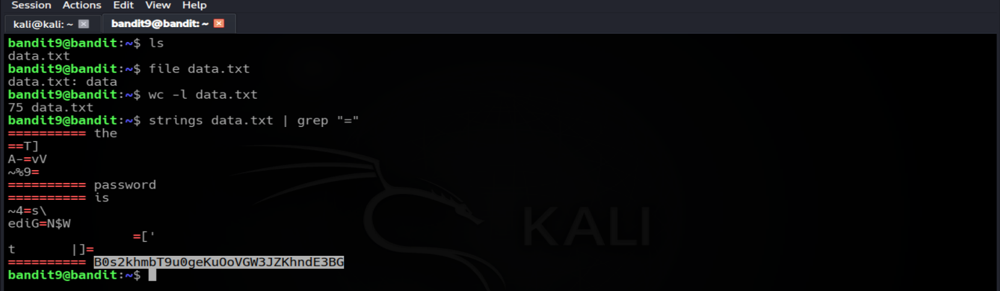

# Bandit Level 9 → Level 10
*Maintained by Muhammad Awais*

## 1. Overview

This level introduces the `strings` command, which is used to extract readable text from files containing binary or non-text data. The objective is to find a human-readable string preceded by several `=` characters inside `data.txt`.

- **Platform:** OverTheWire Bandit
- **Level:** 9 → 10
- **Difficulty:** Beginner
- **Operating System:** Kali GNU/Linux 2026.3 (VM)
- **Connection:** SSH (Port 2220)

## 2. Goal

The password for the next level is stored in `data.txt`.

The file contains binary data and a few human-readable strings. The required password is located in one of those readable strings and is preceded by several `=` characters.

## 3. Approach

1. Connected to the Bandit server as `bandit9` using SSH.
2. Used `file` to identify the type of `data.txt`.
3. Used `strings` to extract readable text from the file.
4. Combined `strings` with `grep` to filter lines containing `=`.
5. Identified the required string and retrieved the next level's password.

## 4. Commands Used

**Identify the file type:**

```bash
file data.txt
```

**Extract human-readable strings containing equal signs:**

```bash
strings data.txt | grep "="
```

Connect to the next level:

```bash
ssh bandit10@bandit.labs.overthewire.org -p 2220
```

## 5. Explanation

### Understanding the file Command

The `file` command identifies the type of a file by examining its contents.

```bash
file data.txt
```

It helps determine whether a file contains ordinary text, binary data, or another file format.

### Understanding the strings Command

The `strings` command extracts sequences of printable characters from files, especially useful when working with binary files.

```bash
strings data.txt
```

Instead of displaying unreadable binary data, it outputs readable text sequences found inside the file.

### Breaking Down the Main Command

```bash
strings data.txt | grep "="
```

- `strings data.txt`: Extracts human-readable text from the file.
- `|`: Sends the output of the first command to the next command.
- `grep`: Searches the received text.
- `"="`: The character being searched for.

**Important Concept:**

Binary files may contain readable text mixed with non-text data. The `strings` command helps extract that readable content, while `grep` filters it to locate specific patterns.

Combining both commands makes it easier to find useful information without manually examining the entire binary file.

## 6. Result

Successfully extracted human-readable strings from `data.txt` and filtered them using `grep` to locate entries containing equal signs.

Identified the required string containing the password for Bandit Level 10.



## 7. Key Takeaway

- Learned how to identify file types using `file`.
- Understood the purpose of the `strings` command.
- Practised extracting readable text from binary files.
- Learned how to filter command output using `grep`.
- Understood how pipes combine commands to locate relevant information.

## Helpful Resources

- [OverTheWire – Bandit Level 10](https://overthewire.org/wargames/bandit/bandit10.html)
- [strings Manual](https://manpages.ubuntu.com/manpages/noble/man1/strings.1.html)
- [grep Manual](https://manpages.ubuntu.com/manpages/noble/man1/grep.1.html)
- [file Manual](https://manpages.ubuntu.com/manpages/noble/man1/file.1.html)