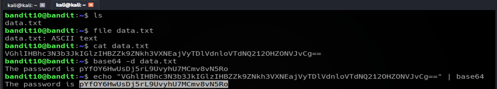

# Bandit Level 10 → Level 11
*Maintained by Muhammad Awais*

## 1. Overview

This level introduces Base64 encoding and decoding in Linux. The objective is to decode the contents of a file containing Base64 encoded data and retrieve the password for the next level.

- **Platform:** OverTheWire Bandit
- **Level:** 10 → 11
- **Difficulty:** Beginner
- **Operating System:** Kali GNU/Linux 2026.3 (VM)
- **Connection:** SSH (Port 2220)

## 2. Goal

The password for the next level is stored in `data.txt`, which contains Base64 encoded data.

The task is to decode the contents of the file to reveal the original readable text containing the password.

## 3. Approach

1. Connected to the Bandit server as `bandit10` using SSH.
2. Used `file` to inspect the type of `data.txt`.
3. Observed that the command identified the file as ASCII text.
4. Recognized that the file contents were Base64 encoded based on the challenge description and the encoded text.
5. Used `base64 -d` to decode the file contents.
6. Practised decoding a Base64 string directly using `echo` and a pipe.

## 4. Commands Used

**Check the file type:**

```bash
file data.txt
```

**Decode the contents of data.txt:**

```bash
base64 -d data.txt
```

**Decode a Base64 string directly:**

```bash
echo "base64EncodedString" | base64 -d
```

Connect to the next level:

```bash
ssh bandit11@bandit.labs.overthewire.org -p 2220
```

*Replace `base64encoded` with an actual Base64 encoded string.*

## 5. Explanation

### Understanding Base64 Encoding

Base64 is an encoding method that converts binary data into a text representation using a set of 64 characters.

It commonly uses:

- Uppercase letters: `A-Z`
- Lowercase letters: `a-z`
- Numbers: `0-9`
- Special characters: `+` and `/`
- Padding character: `=`

Base64 is commonly used to represent binary data in text-based formats and transfer data through systems that handle text.

**Important:** Base64 is encoding, not encryption. It does not protect information with a secret key or password. Anyone can decode Base64 data.

### Understanding the base64 Command

Linux provides the `base64` command to encode and decode data.

**Encoding:**

```bash
echo "Hello Linux" | base64
```

**Decoding:**

```bash
echo "SGVsbG8gTGludXgK" | base64 -d
```

The `-d` option tells the command to decode the supplied Base64 data.

### Breaking Down the Commands

**Method 1: Decode a File**

```bash
base64 -d data.txt
```

- `base64`: Runs the Base64 utility.
- `-d`: Enables decoding mode.
- `data.txt`: Specifies the file containing encoded data.

The decoded output is displayed directly in the terminal. The original file remains unchanged.

**Method 2: Decode a String**

```bash
echo "base64encoded" | base64 -d
```

- `echo`: Prints the supplied string.
- `"base64encoded"`: Represents the Base64 encoded text.
- `|`: Passes the output of `echo` to the next command.
- `base64 -d`: Decodes the received input.

This method is useful when you have a Base64 string instead of a file.

### How to Recognize Base64 Encoded Data?

One important question from this lab is:

**Why did `file data.txt` report ASCII text instead of Base64?**

The reason is that Base64 encoded data consists of ordinary printable ASCII characters.

The `file` command identifies the file based on its contents and recognizable formats. It does not necessarily recognize Base64 encoding as a separate file type.

For example:

```bash
file data.txt
```

Possible output:

```text
data.txt: ASCII text
```

This does not mean the contents are ordinary readable sentences. It only means the file contains ASCII text characters.

**How can we recognize Base64 then?**

Look for these indicators:

1. The content consists mostly of uppercase and lowercase letters, numbers, and possibly `+` or `/`.
2. The data may end with one or two `=` padding characters.
3. The content may look like random text rather than meaningful sentences.
4. The challenge description or source of the data may indicate Base64 encoding.
5. Attempting to decode it using `base64 -d` produces meaningful readable output.

For this particular level, the challenge description explicitly tells us that `data.txt` contains Base64 encoded data.

**Important Concept:**

There is no single visual pattern that guarantees a string is Base64. Some ordinary text can also contain only Base64-compatible characters. The encoding context and successful decoding are important clues.

## 6. Result

Successfully decoded the contents of `data.txt` using the `base64 -d` command.

The decoded output revealed the password required to access Bandit Level 11.



## 7. Key Takeaway

- Learned what Base64 encoding is and why it is used.
- Understood the difference between encoding and encryption.
- Practised decoding files using `base64 -d`.
- Learned to decode individual strings using `echo` and pipes.
- Understood why `file` may identify Base64 encoded content as ASCII text.
- Learned that successful decoding and meaningful output help confirm the encoding.

## Helpful Resources

- [OverTheWire – Bandit Level 11](https://overthewire.org/wargames/bandit/bandit11.html)
- [Base64 – Wikipedia](https://en.wikipedia.org/wiki/Base64)
- [base64 Manual](https://manpages.ubuntu.com/manpages/noble/man1/base64.1.html)