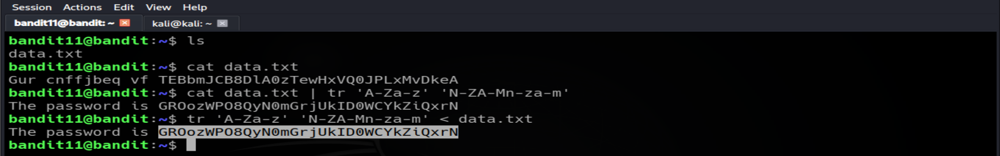

# Bandit Level 11 → Level 12
*Maintained by Muhammad Awais*

## 1. Overview

This level introduces character translation in Linux using the `tr` command. The objective is to decode text that has been transformed using ROT13, a simple substitution cipher that rotates each letter by 13 positions in the alphabet.

- **Platform:** OverTheWire Bandit
- **Level:** 11 → 12
- **Difficulty:** Beginner
- **Operating System:** Kali GNU/Linux 2026.3 (VM)
- **Connection:** SSH (Port 2220)

## 2. Goal

The password for the next level is stored in `data.txt`.

All lowercase (`a-z`) and uppercase (`A-Z`) letters have been rotated by 13 positions using ROT13.

The task is to reverse this transformation and retrieve the original readable text containing the next level's password.

## 3. Approach

1. Connected to the Bandit server as `bandit11` using SSH.
2. Used `cat` to inspect the contents of `data.txt`.
3. Identified that the text was encoded using ROT13 based on the challenge description.
4. Used `tr` to translate each alphabetic character into its corresponding ROT13 character.
5. Practised two methods: using a pipe and redirecting file input directly.
6. Retrieved the password from the decoded output.

## 4. Commands Used

**Display the encoded file contents:**

```bash
cat data.txt
```

**Decode using a pipe:**

```bash
cat data.txt | tr 'A-Za-z' 'N-ZA-Mn-za-m'
```

**Decode using input redirection:**

```bash
tr 'A-Za-z' 'N-ZA-Mn-za-m' < data.txt
```

Connect to the next level:

```bash
ssh bandit12@bandit.labs.overthewire.org -p 2220
```

## 5. Explanation

### Understanding ROT13

ROT13 stands for "Rotate by 13 places."

It is a simple letter substitution technique in which every letter is replaced by the letter 13 positions ahead in the alphabet.

For example:

- `A` becomes `N`.
- `B` becomes `O`.
- `C` becomes `P`.
- `N` becomes `A`.
- `O` becomes `B`.

The same transformation applies to lowercase letters.

**Important Concept:**

The English alphabet contains 26 letters. Rotating by 13 positions twice returns every letter to its original position.

This means ROT13 uses the same operation for both encoding and decoding.

### Understanding the tr Command

`tr` stands for translate. It is a Linux command-line utility used to replace or translate characters from one set into another.

General syntax:

```bash
tr 'SET1' 'SET2'
```

- `SET1`: Contains the characters that need to be translated.
- `SET2`: Contains their corresponding replacement characters.

### Breaking Down the ROT13 Command

```bash
tr 'A-Za-z' 'N-ZA-Mn-za-m' < data.txt
```

**First character set:**

```text
A-Za-z
```

Represents all uppercase and lowercase English letters:

- `A-Z`: Uppercase letters.
- `a-z`: Lowercase letters.

**Second character set:**

```text
N-ZA-Mn-za-m
```

Represents the corresponding ROT13 replacement characters:

- `N-ZA-M`: Maps uppercase letters to their ROT13 equivalents.
- `n-za-m`: Maps lowercase letters to their ROT13 equivalents.

For example:

| Original | ROT13 |
|---|---|
| A | N |
| B | O |
| C | P |
| D | Q |
| N | A |
| O | B |
| a | n |
| b | o |
| n | a |
| o | b |

### Understanding the Two Methods

**Method 1: Using a Pipe**

```bash
cat data.txt | tr 'A-Za-z' 'N-ZA-Mn-za-m'
```

- `cat data.txt` reads and outputs the file contents.
- `|` passes that output to the next command.
- `tr` translates the encoded characters into their original characters.

**Method 2: Using Input Redirection**

```bash
tr 'A-Za-z' 'N-ZA-Mn-za-m' < data.txt
```

- `tr` performs the character translation.
- `<` redirects the contents of `data.txt` into the command as standard input.
- The decoded result is displayed in the terminal.

**Important Concept:**

Both commands perform exactly the same translation.

The second method is shorter because `tr` can read directly from standard input. There is no need to use `cat` and a pipe.

## 6. Result

Successfully decoded the contents of `data.txt` using the `tr` command and ROT13 character translation.

The decoded output revealed the password required to access Bandit Level 12.



## 7. Key Takeaway

- Learned what ROT13 is and how its character rotation works.
- Understood that ROT13 can encode and decode using the same transformation.
- Practised character translation using the `tr` command.
- Learned how character ranges such as `A-Z` and `a-z` work.
- Understood input redirection using `<`.
- Learned that commands can receive input directly without using `cat` and a pipe.

## Helpful Resources

- [OverTheWire – Bandit Level 12](https://overthewire.org/wargames/bandit/bandit12.html)
- [ROT13 – Wikipedia](https://en.wikipedia.org/wiki/ROT13)
- [tr Manual](https://manpages.ubuntu.com/manpages/noble/man1/tr.1.html)
- [Bash Redirections](https://www.gnu.org/software/bash/manual/html_node/Redirections.html)