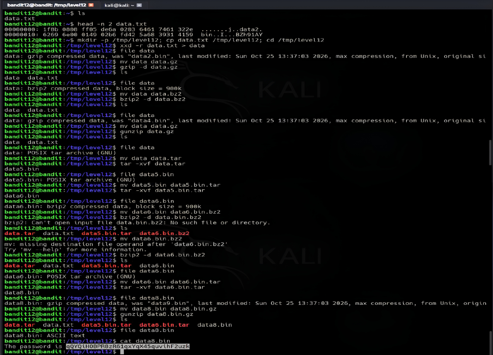

# Bandit Level 12 → Level 13
*Maintained by Muhammad Awais*

## 1. Overview

This level introduces hex dump conversion, file identification, and manual extraction of repeatedly compressed files. I learned how to reverse a hexdump, identify different compression formats using `file`, and manually extract nested compressed files and archives until reaching the original readable text.

- **Platform:** OverTheWire Bandit
- **Level:** 12 → 13
- **Difficulty:** Beginner
- **Operating System:** Kali GNU/Linux 2026.3 (VM)
- **Connection:** SSH (Port 2220)

## 2. Goal

The password for the next level is stored in `data.txt`, which contains a hexdump of a file that has been compressed multiple times.

The task is to:

- Convert the hexdump back into its original binary file.
- Identify the compression format at each stage.
- Manually decompress or extract each layer.
- Continue until reaching a readable text file containing the next level's password.

## 3. Approach

1. Connected to the Bandit server as `bandit12` using SSH.
2. Inspected the available file and examined the first two lines of `data.txt`.
3. Created a temporary working directory under `/tmp`.
4. Copied `data.txt` into the temporary directory.
5. Reconstructed the original binary file using `xxd -r`.
6. Identified each file format using the `file` command.
7. Renamed files with appropriate extensions before decompressing or extracting them.
8. Manually handled the nested gzip, bzip2, and tar layers.
9. Tools like **7-Zip and Unblob** were not available in the Bandit SSH environment because the challenge provides a limited set of preinstalled utilities; these tools can automatically detect and extract multiple compression formats and nested archives, potentially saving us from manually identifying and decompressing each layer one by one using commands like `gzip`, `bzip2`, and `xz`.
9. Repeated the identification and extraction process until reaching an ASCII text file.
10. Read the final text file to retrieve the password.

## 4. Commands Used

### A. Inspect and Prepare the Working Directory

```bash
ls
head -n 2 data.txt
mkdir -p /tmp/level12
cp data.txt /tmp/level12
cd /tmp/level12
```

### B. Convert the Hexdump into a Binary File

```bash
xxd -r data.txt > data
file data
```

### C. Extract the Nested Compression Layers

**First layer gzip:**

```bash
mv data data.gz
gzip -d data.gz
file data
```

**Second layer bzip2:**

```bash
mv data data.bz2
bzip2 -d data.bz2
file data
```

**Third layer gzip:**

```bash
mv data data.gz
gunzip data.gz
file data
```

**Fourth layer tar archive:**

```bash
mv data data.tar
tar -xvf data.tar
file data5.bin
```

**Fifth layer tar archive:**

```bash
mv data5.bin data5.bin.tar
tar -xvf data5.bin.tar
file data6.bin
```

**Sixth layer bzip2:**

```bash
mv data6.bin data6.bin.bz2
bzip2 -d data6.bin.bz2
file data6.bin
```

**Seventh layer tar archive:**

```bash
mv data6.bin data6.bin.tar
tar -xvf data6.bin.tar
file data8.bin
```

**Eighth layer gzip:**

```bash
mv data8.bin data8.bin.gz
gunzip data8.bin.gz
file data8.bin
```

### D. Read the Final File

```bash
cat data8.bin
```

The final file contained readable ASCII text with the password for the next level.

## 5. Explanation

### Understanding Hexdump and xxd

A hexdump represents binary data using hexadecimal values instead of displaying the original content directly.

The `xxd` command is commonly used to create and reverse hexdumps.

- `xxd`: Creates a hexadecimal representation of a file.
- `-r`: Reverses a hexdump back into its original binary data.
- `>`: Redirects the reconstructed output into a file.

In this level, `data.txt` was not an ordinary text file containing the actual compressed data. It was a hexadecimal representation of that data.

Using `xxd -r` reconstructed the original binary file so that it could be identified and extracted.

### Understanding the file Command

The `file` command identifies a file's format by examining its contents rather than relying only on its filename extension.

During this challenge, it helped identify:

- Gzip compressed files.
- Bzip2 compressed files.
- POSIX tar archives.
- ASCII text files.

**Important Concept:**

A file extension does not determine the actual file format. The `file` command helps identify what a file really contains, even when its extension is missing or incorrect.

### Understanding File Extensions and Renaming

Compressed files are easier to manage when they have appropriate extensions.

For example:

- `.gz` indicates gzip compression.
- `.bz2` indicates bzip2 compression.
- `.tar` indicates a tar archive.

The `mv` command was used to rename files before processing them.

Renaming a file does not change its contents or compression format. It only changes its name.

### Understanding the Compression and Extraction Commands

| Command | Purpose |
|---|---|
| `gzip -d` | Decompresses gzip files. |
| `gunzip` | Decompresses gzip files. |
| `bzip2 -d` | Decompresses bzip2 files. |
| `tar -xvf` | Extracts files from a tar archive. |

**Understanding tar options:**

- `-x`: Extract files from an archive.
- `-v`: Display the files being extracted.
- `-f`: Specify the archive filename.

### Understanding Nested Compression

The most important concept in this level is nested compression.

A file can be compressed multiple times using different compression formats. After extracting one layer, the resulting file may still be compressed or may contain another archive.

For this reason, the process must be repeated:

1. Identify the current file format.
2. Rename the file if necessary.
3. Use the appropriate decompression or extraction command.
4. Identify the resulting file again.
5. Repeat until the contents become readable.

**Important Concept:**

Do not assume that extracting one compression layer will reveal the final data. Always inspect the resulting file before deciding what to do next.

## 6. Verification

The lab requirements were verified by checking that:

- The original hexdump was successfully converted into binary data.
- The temporary working directory was created successfully.
- Each compression format was identified using `file`.
- Gzip and bzip2 layers were decompressed successfully.
- Tar archives were extracted successfully.
- The extraction process continued through all nested layers.
- The final file was identified as ASCII text.
- The final text file revealed the password for Bandit Level 13.

## 7. Result

Successfully reconstructed the binary file from its hexdump and manually extracted all nested compression and archive layers.

Reached the final ASCII text file containing the password required to access Bandit Level 13.



## 8. Key Takeaway

- Learned how to reverse a hexdump using `xxd -r`.
- Understood how to identify actual file formats using `file`.
- Practised decompressing gzip and bzip2 files.
- Learned how to extract tar archives.
- Understood why file extensions are useful when working with compressed files.
- Practised manually handling multiple layers of compression.
- Learned to inspect every extracted file before proceeding to the next step.
- Understood why automated extraction tools are not always necessary.

## Helpful Resources

- [OverTheWire – Bandit Level 13](https://overthewire.org/wargames/bandit/bandit13.html)
- [Hex Dump – Wikipedia](https://en.wikipedia.org/wiki/Hex_dump)
- [xxd Manual](https://manpages.ubuntu.com/manpages/noble/man1/xxd.1.html)
- [file Manual](https://manpages.ubuntu.com/manpages/noble/man1/file.1.html)
- [gzip Manual](https://manpages.ubuntu.com/manpages/noble/man1/gzip.1.html)
- [bzip2 Manual](https://manpages.ubuntu.com/manpages/noble/man1/bzip2.1.html)
- [tar Manual](https://manpages.ubuntu.com/manpages/noble/man1/tar.1.html)