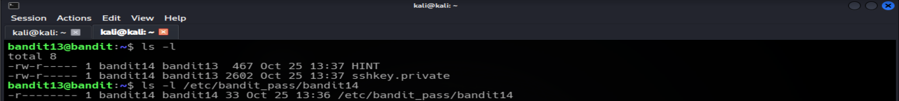
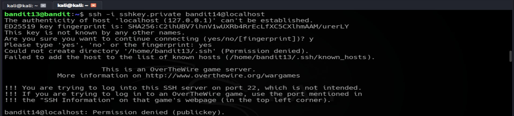
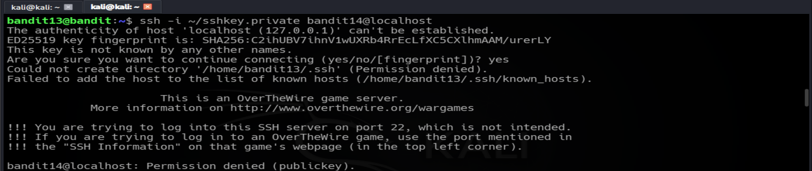
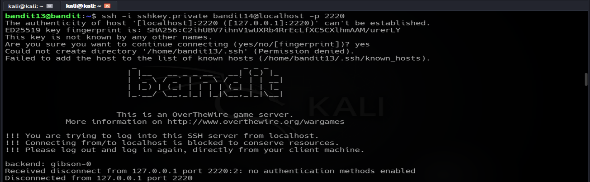
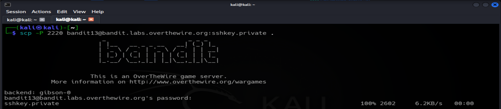
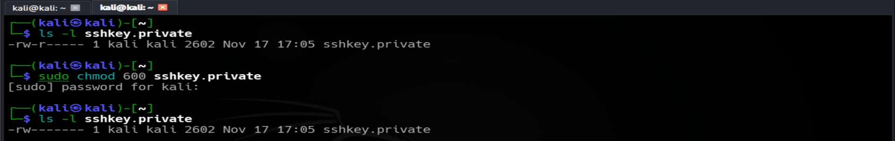
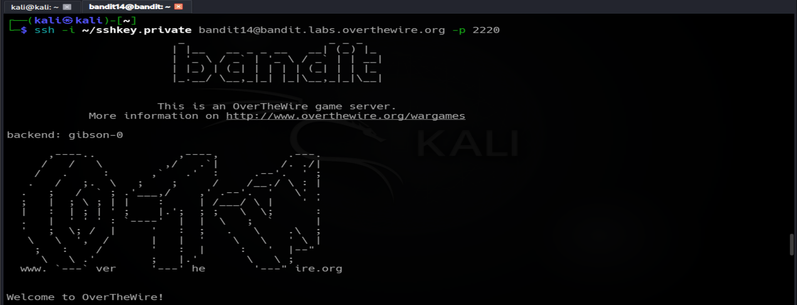
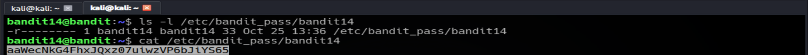

# Bandit Level 13 → Level 14
*Maintained by Muhammad Awais*

## 1. Overview

This level introduces SSH key-based authentication. Instead of finding a password for the next level, we are provided with a private SSH key that allows us to authenticate as `bandit14`.

During this challenge, I learned how to inspect SSH key files, understand SSH connection errors, transfer a private key from a remote server to a local machine using SCP, set secure file permissions, and connect to another account using private-key authentication.

- **Platform:** OverTheWire Bandit
- **Level:** 13 → 14
- **Difficulty:** Beginner
- **Operating System:** Kali GNU/Linux 2026.3 (VM)
- **Connection:** SSH (Port 2220)

## 2. Goal

The password for the next level is stored in:

`/etc/bandit_pass/bandit14`

This file can only be read by user `bandit14`.

Instead of providing the password directly, the challenge provides a private SSH key named `sshkey.private` in the `bandit13` home directory.

The objective is to use this private key to log in as `bandit14` and then read the password file.

## 3. Approach

The solution required understanding where the SSH connection was being initiated.

My initial approach was to use the private key directly from the `bandit13` account and connect to `localhost`. However, OverTheWire does not allow this type of connection between Bandit accounts through localhost.

The correct approach was:

1. Connect to the server as `bandit13` from Kali.
2. Inspect the password file permissions and available files.
3. Locate the provided private SSH key.
4. Attempt SSH authentication using the private key.
5. Understand why the localhost connection attempts failed.
6. Exit the remote server and return to local Kali.
7. Transfer the private key to Kali using SCP.
8. Set secure permissions on the private key.
9. Connect directly from Kali to the remote server as `bandit14`.
10. Read the password file using the newly authenticated account.

## 4. Commands Used

### Task 1: Connect to Bandit Level 13

**Command:**

```bash
ssh bandit13@bandit.labs.overthewire.org -p 2220
```

**Explanation:**

- `ssh` starts a secure remote connection.
- `bandit13` is the username.
- `bandit.labs.overthewire.org` is the remote server.
- `-p 2220` specifies the SSH port.

After entering the Level 13 password, I successfully logged in as `bandit13`.

### Task 2: Inspect the Password File and Available Files

**Commands:**

```bash
ls -l /etc/bandit_pass/bandit14
ls -l
```

**Explanation:**

The first command checks the permissions and ownership of the next level's password file.

The output showed:

```text
-r-------- 1 bandit14 bandit14 33 ... /etc/bandit_pass/bandit14
```

This tells us:

- Owner: `bandit14`
- Group: `bandit14`
- Permissions: `r--------`
- Only the file owner has read permission.

The second command lists the contents of the current home directory.

It revealed two important files:

- `HINT` a hint file for the challenge.
- `sshkey.private` the private SSH key provided for authentication as `bandit14`.

**Important Concept:**

The private key is an authentication credential. It allows us to prove our identity to the SSH server without entering the target account's password.



### Task 3: First Failed SSH Attempt — Default Port

**Command:**

```bash
ssh -i sshkey.private bandit14@localhost
```

**What happened?**

The connection failed with messages including:

```text
Could not create directory '/home/bandit13/.ssh' (Permission denied).
Failed to add the host to the list of known hosts.
```

It also displayed:

```text
You are trying to log into this SSH server on port 22,
which is not intended.
```

And finally:

```text
bandit14@localhost: Permission denied (publickey).
```

**Why did it fail?**

There were two main problems:

1. **Wrong port:** SSH uses port `22` by default if we do not specify another port. OverTheWire Bandit uses port `2220`.
2. **Localhost:** `localhost` means the machine where the command is running. Since I was already inside the Bandit server, this attempted to connect from the remote server to itself.

The `.ssh` warning appeared because the current Bandit home directory did not allow creating the SSH configuration directory or saving the host key.

This warning was not the main authentication problem.



### Task 4: Second Failed SSH Attempt — Using the Home Directory Path

**Command:**

```bash
ssh -i ~/sshkey.private bandit14@localhost
```

**What happened?**

The same connection and authentication errors appeared.

**Why did it fail?**

The only change was the way the private key's path was written.

- `sshkey.private` refers to the file in the current directory.
- `~/sshkey.private` refers to the file in the current user's home directory.

Both paths pointed to the same private key in this situation.

However, this did not fix either of the actual problems:

- The connection still used the default port 22.
- The destination was still `localhost`.

**Important Concept:**

Changing the file path does not change the destination server or SSH port.



### Task 5: Third Failed SSH Attempt — Correct Port, Wrong Destination

**Command:**

```bash
ssh -i sshkey.private bandit14@localhost -p 2220
```

**What happened?**

This time, the port was correct. However, the server displayed:

```text
Connecting from/to localhost is blocked to conserve resources.

Please log out and log in again, directly from your client machine.
```

The connection was then disconnected.

**Why did it fail?**

Adding `-p 2220` fixed the port issue, but the destination was still `localhost`.

OverTheWire deliberately blocks connections from one Bandit account to another through localhost.

The server expects the SSH connection to originate directly from the player's own client machine.

**Important Concept:**

The private key should be transferred to Kali, and the connection to `bandit14` should be initiated from Kali rather than from the existing `bandit13` session.



### Task 6: Exit the Remote Server

**Command:**

```bash
exit
```

This closes the current SSH session and returns to the local Kali terminal.

**Important Concept:**

There is a difference between your local machine and a remote server.

- Local machine: Your Kali Linux VM.
- Remote machine: The OverTheWire Bandit server.

The private key was originally stored on the remote server, so it needed to be copied to Kali before making the new connection.


### Task 7: Transfer the Private Key to Kali

**Command:**

```bash
scp -P 2220 bandit13@bandit.labs.overthewire.org:sshkey.private .
```

**Explanation:**

- `scp` securely copies files between computers.
- `-P 2220` specifies the SSH port. Notice that SCP uses an uppercase `P`.
- `bandit13` is the remote username.
- `bandit.labs.overthewire.org` is the remote server.
- `:sshkey.private` identifies the file to copy from the remote account.
- `.` means save the file in the current local directory.

After authentication, the private key is copied from the Bandit server to Kali.

**Important Concept:**

SCP uses SSH for secure file transfer. It allows us to download a file from a remote system without manually copying its contents.



### Task 8: Inspect and Secure the Private Key

**Commands:**

```bash
ls -l
chmod 600 ~/sshkey.private
ls -l
```

**Explanation:**

The first command checks that the private key is available on Kali.

The second command changes its permissions.

`chmod 600` means:

| Permission | Meaning |
|---|---|
| Owner: 6 | Read and write |
| Group: 0 | No permissions |
| Others: 0 | No permissions |

SSH private keys should be protected from access by other users. If a private key is accessible to other users, SSH may reject it as insecure.

The final listing allows us to check the updated permissions.

**Important Concept:**

A private key must remain private. Restricting its permissions helps protect it from unauthorized access.



### Task 9: Successfully Connect as Bandit 14

**Command:**

```bash
ssh -i ~/sshkey.private bandit14@bandit.labs.overthewire.org -p 2220
```

**Explanation:**

- `ssh` starts the connection.
- `-i` specifies the identity file (private key) to use.
- `~/sshkey.private` is the location of the private key on Kali.
- `bandit14` is the target username.
- `bandit.labs.overthewire.org` is the remote server.
- `-p 2220` specifies the correct SSH port.

This time, the connection is initiated directly from Kali to the Bandit server.

The private key is used for authentication, and I successfully logged in as:

```text
bandit14@bandit:~$
```



### Task 10: Read the Next Level Password

**Command:**

```bash
cat /etc/bandit_pass/bandit14
```

**Explanation:**

- `cat` displays the contents of a file.
- `/etc/bandit_pass/bandit14` is the password file.
- Because I am now logged in as `bandit14`, I have permission to read it.

The command displays the password required for the next Bandit level.

**Security Note:**

Never include the actual password in public GitHub documentation, screenshots, or README files.



## 5. Verification

The successful login confirmed that the private key was accepted and that I had authenticated as `bandit14`.

The password file was then successfully read using the authenticated account.

The main verification points were:

- The private key was available on the local Kali machine.
- Its permissions were restricted to the owner.
- SSH connected directly to the Bandit server on port `2220`.
- The terminal prompt changed to `bandit14@bandit`.
- The password file became readable.

## 6. Key Takeaways

- SSH supports password-based and public-key-based authentication.
- A private key can authenticate a user without entering their account password.
- `-i` specifies the private key used by SSH.
- `localhost` refers to the machine where the command is executed.
- OverTheWire blocks Bandit-to-Bandit localhost connections.
- `scp` transfers files securely between local and remote machines.
- SCP uses uppercase `-P` for the port, while SSH uses lowercase `-p`.
- `chmod 600` restricts a private key to its owner's read and write permissions.
- SSH may reject private keys with insecure permissions.
- File permissions determine which users can access protected files.
- Always read SSH error messages carefully; they often explain exactly why a connection failed.

## 7. Result

Successfully completed Bandit Level 13 → Level 14 by using the provided private SSH key.

After understanding and correcting the failed localhost connection attempts, I transferred the private key to my Kali machine, restricted its permissions, and authenticated directly as `bandit14`.

Finally, I read `/etc/bandit_pass/bandit14` and retrieved the password for the next level.

## Helpful Resources

- [OverTheWire – Bandit Level 14](https://overthewire.org/wargames/bandit/bandit14.html)
- [Ubuntu – SSH/OpenSSH/Keys](https://help.ubuntu.com/community/SSH/OpenSSH/Keys)
- [Ubuntu – Transferring Files via SCP](https://help.ubuntu.com/community/SSH/TransferFiles)
- [Linux Manual – ssh](https://man7.org/linux/man-pages/man1/ssh.1.html)
- [Linux Manual – scp](https://man7.org/linux/man-pages/man1/scp.1.html)
- [Linux Manual – chmod](https://man7.org/linux/man-pages/man1/chmod.1.html)