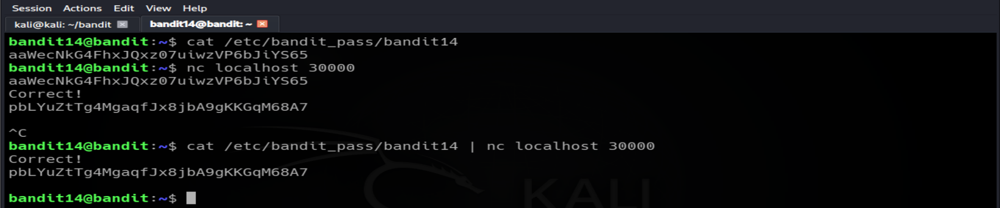
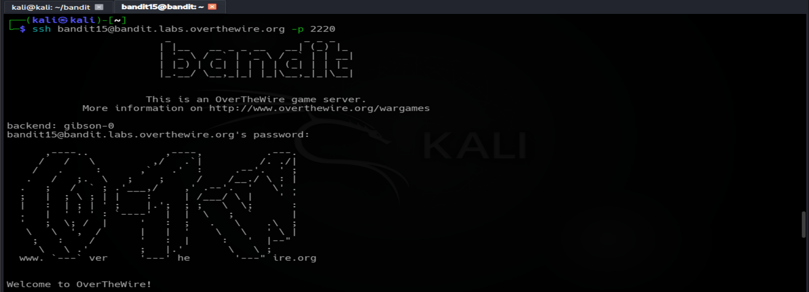

# Bandit Level 14 → Level 15
*Maintained by Muhammad Awais*

## 1. Overview

This level introduces basic network communication using localhost and port numbers. Instead of reading the next password directly from a file, we need to submit the current level's password to a service listening on port `30000`.

In this challenge, I learned how to communicate with a network service using Netcat (`nc`) and how localhost and port numbers are used to identify a service running on a machine.

- **Platform:** OverTheWire Bandit
- **Level:** 14 → 15
- **Difficulty:** Beginner
- **Operating System:** Kali GNU/Linux 2026.3 (VM)
- **Connection:** SSH (Port 2220)

## 2. Goal

The password for Level 15 can be retrieved by submitting the current Level 14 password to port `30000` on localhost.

The objective is to connect to the service running on port `30000`, provide the current password, and receive the password for the next level.

## 3. Approach

1. Connect to the Bandit server as `bandit14`.
2. Use the current Level 14 password obtained in the previous challenge.
3. Connect to localhost on port `30000` using Netcat.
4. Submit the current password to the service.
5. Read the response returned by the service.
6. Use the retrieved password to log in as `bandit15`.

## 4. Commands Used

### Task 1: Connect to Bandit Level 14

**Command:**

```bash
ssh bandit14@bandit.labs.overthewire.org -p 2220
```

**Explanation:**

- `ssh` starts a secure remote connection.
- `bandit14` is the username.
- `bandit.labs.overthewire.org` is the Bandit server.
- `-p 2220` specifies the SSH port.

### Task 2: Connect to Localhost on Port 30000

**Command:**

```bash
nc localhost 30000
cat /etc/bandit_pass/bandit14 | nc localhost 30000
```

**Explanation:**

- `nc` stands for Netcat. It is a command-line networking tool used to communicate with network services.
- `localhost` refers to the same machine where the command is running.
- `30000` is the port number of the service we want to contact.
- The second command directly pipes the password to Netcat on port 30000

After running the command, Netcat establishes a connection to the service.

### Task 3: Submit the Current Password

Once the connection is established, enter the current Level 14 password and press Enter.

The service checks the submitted password and returns the password for Level 15 if it is correct.

**Important Concept:**

The password is being sent as input to a network service. We are not reading the next password from a file in this challenge.



### Task 4: Connect to Level 15

After retrieving the next password, use it to connect to the next level.

**Command:**

```bash
ssh bandit15@bandit.labs.overthewire.org -p 2220
```

Enter the password obtained from the Netcat service when prompted.



## 5. Verification

The challenge is successfully completed when:

- Netcat establishes a connection to localhost on port `30000`.
- The current Level 14 password is accepted.
- The service returns the Level 15 password.
- The retrieved password allows authentication as `bandit15`.

## 6. Key Takeaways

- `localhost` refers to the machine on which a command is running.
- An IP address identifies a machine or network interface.
- A port identifies a particular network service or application endpoint.
- `nc` (Netcat) can establish TCP connections and exchange data.
- A service can receive input through a network connection and return a response.
- SSH port `2220` and service port `30000` serve different purposes.
- Always understand which machine you are connecting from and which service you are connecting to.

## 7. Result

Successfully completed Bandit Level 14 → Level 15 by connecting to the service running on localhost port `30000`, submitting the current level password, and retrieving the next level password.

## Helpful Resources

- [OverTheWire – Bandit Level 15](https://overthewire.org/wargames/bandit/bandit15.html)
- [Netcat Manual](https://man7.org/linux/man-pages/man1/nc.1.html)
- [Localhost – Wikipedia](https://en.wikipedia.org/wiki/Localhost)
- [IP Address – Wikipedia](https://en.wikipedia.org/wiki/IP_address)
- [Port – Wikipedia](https://en.wikipedia.org/wiki/Port_(computer_networking))