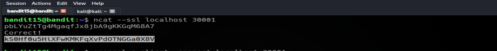
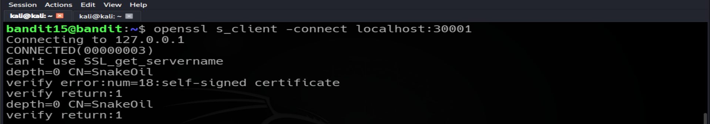
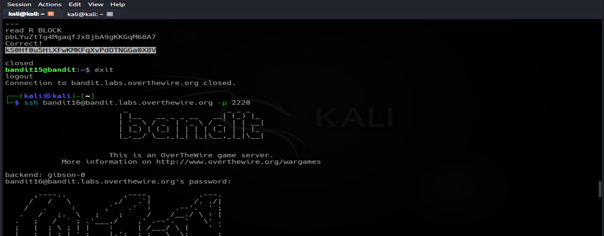
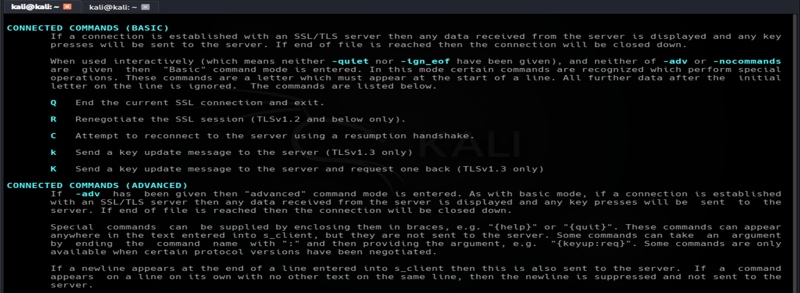

# Bandit Level 15 → Level 16
*Maintained by Muhammad Awais*

## 1. Overview

This level introduces secure network communication using SSL/TLS encryption. Similar to the previous level, we need to submit the current level's password to a service running on localhost. However, this time the service listens on port `30001` and requires an encrypted connection.

I explored two tools for establishing this connection: Ncat with SSL enabled and OpenSSL's `s_client`.

- **Platform:** OverTheWire Bandit
- **Level:** 15 → 16
- **Difficulty:** Beginner
- **Operating System:** Kali GNU/Linux 2026.3 (VM)
- **Connection:** SSH (Port 2220)

## 2. Goal

The password for Level 16 can be retrieved by submitting the current Level 15 password to port `30001` on localhost using SSL/TLS encryption.

The objective is to establish an encrypted connection, submit the current password, and receive the password for the next level.

## 3. Learning Objectives

- Understand the difference between normal TCP communication and SSL/TLS-encrypted communication.
- Understand the purpose of SSL and TLS.
- Connect to an encrypted service using Ncat.
- Use OpenSSL's `s_client` to establish and test a TLS connection.
- Understand the TLS handshake.
- Recognise connection messages such as `DONE`, `RENEGOTIATING`, and `KEYUPDATE`.

## 4. Lab Environment

- **Operating System:** Kali GNU/Linux 2026.3 (VM)
- **Platform:** OverTheWire Bandit
- **Access Method:** SSH and Linux terminal
- **User Account:** bandit15
- **Tools Used:** `ssh`, `ncat`, `openssl s_client`

## 5. Practical Tasks

### Task 1: Connect to Bandit Level 15

**Command:**

```bash
ssh bandit15@bandit.labs.overthewire.org -p 2220
```

**Explanation:**

- `ssh` establishes a secure remote connection.
- `bandit15` is the username.
- `bandit.labs.overthewire.org` is the Bandit server.
- `-p 2220` specifies the SSH port.

After logging in, we can communicate with the service running on the same server.

### Task 2: Connect Using Ncat with SSL/TLS

**Command Used:**

```bash
ncat --ssl localhost 30001
```

**Explanation:**

- `ncat` is a networking utility that can establish connections and exchange data.
- `--ssl` enables SSL/TLS encryption for the connection.
- `localhost` refers to the machine where the command is executed.
- `30001` is the port where the target service is listening.

After establishing the connection, submit the current Level 15 password and press Enter.

The service checks the submitted password and returns the Level 16 password if it is correct.

**Important Concept:**

Normal Netcat communication does not automatically encrypt data. Ncat's `--ssl` option enables an encrypted connection.



### Task 3: Connect Using OpenSSL s_client

**Standard OpenSSL Command Syntax:**

```bash
openssl s_client -connect localhost:30001
```

**Explanation:**

- `openssl` is a toolkit for cryptographic operations and secure communication.
- `s_client` starts OpenSSL's SSL/TLS client mode.
- `-connect` specifies the destination hostname and port.
- `localhost:30001` identifies the service we want to connect to.

After the TLS handshake completes, submit the current Level 15 password and press Enter.

The server should return the next level's password if the submitted password is correct.




**Important Concept:**

OpenSSL's `s_client` is useful for testing TLS-enabled services. It displays information about the connection, including certificate and handshake details.

### Task 4: Understand the TLS Connection Messages

While using OpenSSL, you may encounter messages such as:

- `DONE:` Indicates that the communication or operation has finished. (Finish the communication)

- `RENEGOTIATING:` Means the client is requesting a new TLS handshake to renegotiate the security settings of an existing connection. Traditional renegotiation is supported in TLS 1.2 and earlier, but not TLS 1.3. (Negotiate the security settings again)

- `KEYUPDATE:` Refreshes the encryption keys used by an existing TLS 1.3 connection without creating an entirely new connection. (Refresh the encryption keys)

These messages are related to OpenSSL's interactive connected commands and TLS connection handling.

They are not passwords or necessarily errors. Refer to the `CONNECTED COMMANDS` section of the OpenSSL `s_client` manual to understand them.



## 6. Key Takeaways

- Normal TCP communication does not automatically encrypt the data being transmitted.
- SSL/TLS provides encryption for network communication.
- TLS is the modern successor to the older SSL protocols.
- `ncat --ssl` establishes an encrypted connection using Ncat.
- `openssl s_client` is used to connect to and inspect SSL/TLS services.
- `localhost` refers to the current machine.
- Port `30001` is the service port used in this challenge.
- SSH port `2220` and service port `30001` have different purposes.
- A TLS handshake establishes the secure connection before application data is exchanged.

## Helpful Resources

- [OverTheWire – Bandit Level 16](https://overthewire.org/wargames/bandit/bandit16.html)
- [OpenSSL s_client Manual](https://docs.openssl.org/3.0/man1/openssl-s_client/)
- [OpenSSL Cookbook – Testing with OpenSSL](https://www.feistyduck.com/library/openssl-cookbook/online/testing-with-openssl/index.html)
- [Transport Layer Security – Wikipedia](https://en.wikipedia.org/wiki/Transport_Layer_Security)