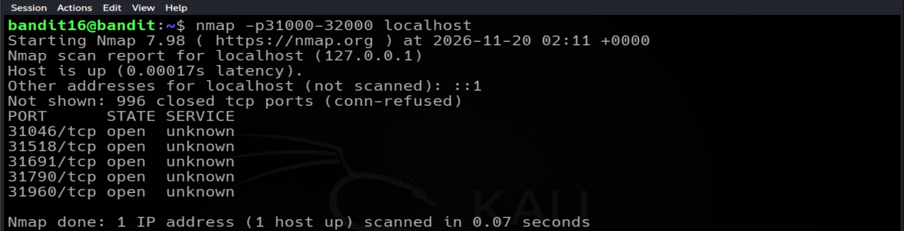
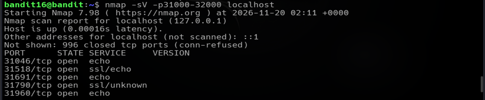
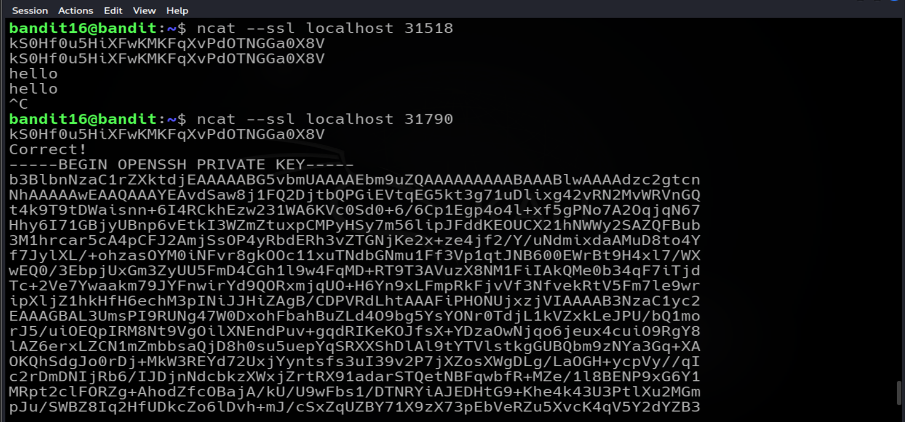
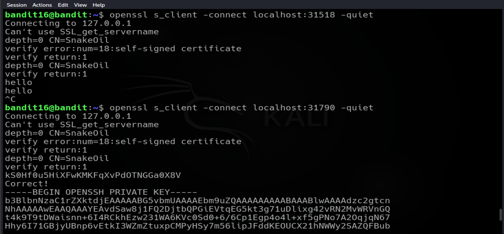
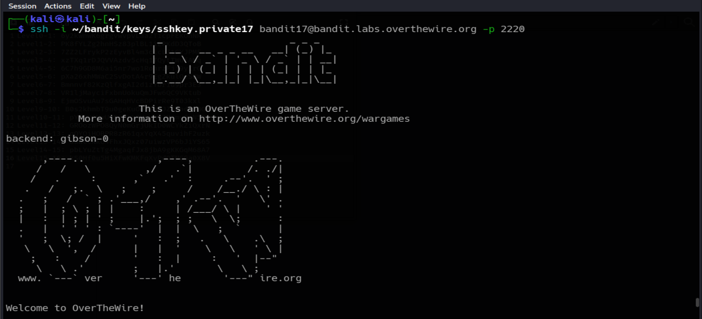

# Bandit Level 16 → Level 17
*Maintained by Muhammad Awais*

## 1. Overview

This level focuses on network port scanning, service detection, and identifying SSL/TLS-enabled services. I used Nmap to discover open ports and inspect their services, then tested the relevant port using both Ncat and OpenSSL to retrieve the SSH private key for the next level.

- **Platform:** OverTheWire Bandit
- **Level:** 16 → 17
- **Difficulty:** Beginner
- **Operating System:** Kali GNU/Linux 2026.3 (VM)
- **Connection:** SSH (Port 2220)

## 2. Goal

Find the listening ports on localhost within the range `31000–32000`. Identify which services support SSL/TLS and determine which one provides the credentials for the next level.

## 3. Approach

1. Scan the specified port range using Nmap to discover open ports.
2. Perform service and version detection to gather more information about the listening services.
3. Identify the port running an SSL/TLS-enabled service.
4. Connect to the identified port using Ncat with SSL enabled.
5. Test the same port using OpenSSL for additional practice.
6. Submit the current level password to retrieve the SSH private key.
7. Use the private key to connect to the next level.

## 4. Commands Used

```bash
nmap -p31000-32000 localhost

nmap -sV -p31000-32000 localhost

ncat --ssl localhost 31790

openssl s_client -connect localhost:31790 -quiet

ssh -i <private-key-file> bandit17@bandit.labs.overthewire.org -p 2220
```

## 5. Explanation

### Nmap Port Scanning

`nmap -p31000-32000 localhost`

- `nmap`: Network exploration and port-scanning tool.
- `-p31000-32000`: Scans ports from 31000 through 32000.
- `localhost`: Targets the local machine.

The first scan identifies open ports within the specified range.


### Service Detection

`nmap -sV -p31000-32000 localhost`

- `-sV`: Enables service and version detection.

This helps identify which services are listening on the discovered open ports. The service information helps narrow down the ports that need further testing.



### Ncat with SSL/TLS

`ncat --ssl localhost 31790`

- `ncat`: A networking utility used to establish connections between systems.
- `--ssl`: Enables SSL/TLS for the connection.
- `localhost`: Connects to the local machine.
- `31790`: The identified service port.

Ncat establishes an encrypted connection to the service. After connecting, the current level password is submitted to retrieve the private key.



### OpenSSL Connection

`openssl s_client -connect localhost:31790 -quiet`

- `openssl s_client`: A command-line tool for testing SSL/TLS connections.
- `-connect`: Specifies the destination host and port.
- `-quiet`: Reduces connection output by suppressing some session information.

OpenSSL provides another way to establish and inspect an SSL/TLS connection. I used it to repeat the same task for additional practice.



### SSH Authentication Using a Private Key

`ssh -i <private-key-file> bandit17@bandit.labs.overthewire.org -p 2220`

The retrieved private key can be used instead of a password to authenticate to the next Bandit account.

- `-i`: Specifies the identity file (private key).
- `bandit17`: The next level's username.
- `-p 2220`: Specifies the SSH port.



## 6. Result

Successfully identified the relevant SSL/TLS-enabled service on port `31790`. Submitting the current level password returned the SSH private key required for authentication to Bandit Level 17.

## 7. Key Takeaways

- Learned how to scan a range of ports using Nmap.
- Practiced identifying running services with `-sV`.
- Understood how to test SSL/TLS-enabled services.
- Practiced connecting to services using both Ncat and OpenSSL.
- Learned how private keys can be used for SSH authentication.
- Understood the importance of port scanning and service identification in network security.

## Helpful Resources

- [OverTheWire – Bandit Level 16](https://overthewire.org/wargames/bandit/bandit16.html)
- [Nmap Reference Guide](https://nmap.org/book/man.html)
- [Ncat Documentation](https://nmap.org/ncat/)
- [OpenSSL Documentation](https://docs.openssl.org/)